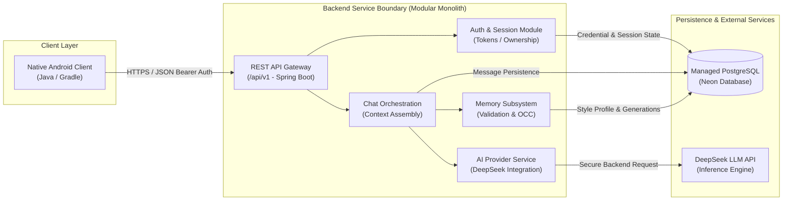

# MIRA — System Overview & Executive Summary

| Attribute | Value |
| :--- | :--- |
| **Document ID** | MIRA-DOC-000 |
| **Classification** | Internal Engineering Specification |
| **Status** | Approved Baseline |
| **Version** | 1.2.0 |
| **Last Updated** | 2026-10-23 |
| **Author / Lead** | Bryan / MIRA Architecture Team |
| **Target Audience** | Engineering, QA, Project Stakeholders |

---

## Document Revision History

| Version | Date | Author | Description of Changes |
| :--- | :--- | :--- | :--- |
| 0.1.0 | 2026-10-10 | Architecture Team | Initial concept baseline and product overview draft. |
| 1.0.0 | 2026-10-11 | Bryan | Enterprise standardization: added document control block, architecture flowchart, and cross-specification linkages. |
| 1.1.0 | 2026-10-21 | Bryan | Reconciled the runtime baseline with the implemented scaffold (Java 21, Spring Boot 4.1.x) and added the Phase 1 milestone to the specification roadmap. |
| 1.2.0 | 2026-10-23 | Bryan | Reconciled Phase 1 delivery progress: conversation management, messaging orchestration, response lifecycle, and MockAIProvider completed on backend. |

---

## 1. Executive Summary

**MIRA** (**M**emory-**I**nformed **R**esponse **A**gent) is a personalized conversational artificial intelligence system engineered to maintain high-fidelity communication style persistence across independent conversation sessions. 

Traditional conversational assistants suffer from session amnesia: they fail to retain how an individual user prefers information delivered (e.g., depth of technical explanation, preferred pedagogical style, structured vs. prose formatting, and tone). As a result, users are forced to repeatedly prompt the system with boilerplate formatting and persona constraints.

MIRA resolves this friction by introducing an isolated, asynchronous **Persistent Communication-Style Memory Subsystem**. Operating on the principle that *"memory informs responses; it does not define the user,"* MIRA selectively identifies durable communication preferences, subjects them to validation and optimistic concurrency control, and injects them into downstream response generation—all while granting the user total inspection, editing, and deletion authority.

---

## 2. Problem Statement & Value Proposition

### 2.1 The Core Problem: Cross-Session Style Friction
Foundation language model interfaces isolate chat sessions into independent context windows. A user who prefers succinct mathematical summaries or concrete real-world code analogies must either configure a global, rigid system instruction or repeat their preferences in every new conversation.

### 2.2 The MIRA Solution
MIRA establishes a decoupled, persistent user style profile that automatically informs responses in subsequent sessions without leaking biographical details or unverified ephemeral instructions.

> [!IMPORTANT]
> **Core Behavioral Invariant:**
> 1. Explicit user instructions in the current prompt **always** take precedence over historical preferences.
> 2. Direct user corrections to their profile **always** take precedence over automated inferences.
> 3. Memory strictly encompasses *communication style*—it is not a personal biographical repository.

---

## 3. Product Goals & Non-Goals

### 3.1 Primary Goals (MVP)
* **Native Mobile Experience:** Provide a responsive, stable Android application built in Java.
* **Secure Monolith Gateway:** Host all authentication, session management, and third-party AI keys exclusively on a secure Java/Spring Boot backend.
* **Persistent Session History:** Reliably persist conversations, messages, and retry attempts within PostgreSQL.
* **Style Memory Lifecycle:** Extract, validate, merge, and apply communication-style profiles using optimistic concurrency control (OCC).
* **Complete User Sovereignty:** Equip users with full visibility and control to view, edit, disable, or permanently purge their style memory.
* **High Reliability & Deterministic Verification:** Provide end-to-end automated test suites that verify business logic and authorization without requiring billable third-party API calls.

### 3.2 Explicit Non-Goals (MVP Boundary)
* **No Foundation Model Training:** MIRA does not pre-train or fine-tune models; it orchestrates external provider APIs.
* **No Biographical Knowledge Graph:** Personal life details, financial data, health information, and political opinions are strictly excluded from memory extraction.
* **No Autonomous Multi-Agent Graphs:** The system focuses on robust single-agent assistant conversations rather than unbounded multi-agent task execution.
* **Deferred Multimodal Ingestion:** Ingestion of PDFs and images is deferred until after the Phase 1 chat core and Phase 2 memory subsystem are verified.

---

## 4. System Architecture & Technology Stack

The MIRA platform adopts an enterprise **Modular Monolith** architecture, balancing low operational overhead with strict domain boundary separation:

| Subsystem | Selected Technology | Architectural Rationale |
| :--- | :--- | :--- |
| **Mobile Client** | Android (Java, Gradle) | Native performance, standard OS security (Keystore), device document pickers. |
| **Backend Service** | Java 21, Spring Boot 4.1.x, Maven | Enterprise-grade type safety, robust transaction management, modular structure. |
| **Database Engine** | PostgreSQL (Neon Managed) | ACID guarantees, JSONB document querying, rock-solid schema migrations via Flyway. |
| **AI Inference Provider** | DeepSeek API | High-performance reasoning and conversational intelligence via an abstracted provider interface. |
| **Protocol & Transport** | HTTPS / REST / JSON | Uniform `/api/v1` contract, deterministic error payloads, and Bearer authentication. |
| **Continuous Integration** | GitHub Actions / Maven / Gradle | Repeatable containerized builds and automated test suites without external dependencies. |

---

## 5. Architectural Principles

1. **Memory Informs, Never Dictates:** Memory is advisory personalization. It must never bypass application security rules or override current user intent.
2. **Absolute Secret Isolation:** Under no circumstances are provider keys (DeepSeek API keys) or database credentials distributed to client APKs.
3. **Server-Side Authorization Everywhere:** Every user-owned entity (conversation, message, profile) is strictly authenticated and authorized on the server; client-supplied IDs are never trusted blindly.
4. **Resilient Failure Semantics:** If an external AI provider experiences an outage or timeout, conversation integrity is preserved, idempotency guards prevent duplicate billing, and failure states are reported cleanly.
5. **Deterministic Verifiability:** Core workflows, authorization invariants, and memory merge logic must be 100% testable using simulated test doubles (Mocks/Testcontainers) without incurred API costs.

### 5.1 Delivery Phases

| Phase | Status | Scope |
| :--- | :--- | :--- |
| **Phase 0** | Complete (Android APK verification carried into Phase 1) | Repository, toolchain, backend/Android skeletons, Flyway baseline |
| **Phase 1** | **Active** | Conversation API, message orchestration, AI provider abstraction, Android auth/chat client, hardening, CI |
| **Phase 2** | Planned | Communication-style memory governance, extraction, OCC/generation concurrency, memory UI |
| **Phase 3** | Planned | Production hardening, deployment, release signing, operational readiness |

Phase 1 deliberately delivers a usable text-chat loop without memory. Memory is the Phase 2 differentiator and remains specified in [05-memory-lifecycle.md](./05-memory-lifecycle.md).

---

## 6. Specification Document Roadmap

The complete engineering specification is partitioned into modular, version-controlled documents:

* [01-requirements.md](./01-requirements.md) — Comprehensive Product Requirements Specification (PRS).
* [02-architecture.md](./02-architecture.md) — System Architecture, Module Boundaries, and Failure Semantics.
* [03-domain-model.md](./03-domain-model.md) — Relational Domain Model, PostgreSQL Schemas, and Constraints.
* [04-api-contract.md](./04-api-contract.md) — RESTful HTTP Interface, Request/Response Schemas, and Idempotency.
* [05-memory-lifecycle.md](./05-memory-lifecycle.md) — Style Memory Extraction, Validation, and Concurrency Controls.
* [06-security-and-privacy.md](./06-security-and-privacy.md) — Threat Modeling, Token Lifecycles, and Data Privacy Standards.
* [07-testing-strategy.md](./07-testing-strategy.md) — Multi-Tier Quality Assurance, Testcontainers, and Mocking Strategy.
* [08-deployment-plan.md](./08-deployment-plan.md) — Cloud Infrastructure Topology, Flyway Migrations, and Release Runbooks.
* [09-phase-0-checklist.md](./09-phase-0-checklist.md) — Phase 0 Repository Baseline, Verification Steps, and Readiness Gates (complete; Android APK verification carried into Phase 1).
* [10-phase-1-checklist.md](./10-phase-1-checklist.md) — Phase 1 Conversation & Chat Core milestone, workstreams, and exit gate.
* [ADR-001-backend-stack.md](./decisions/ADR-001-backend-stack.md) — Architectural Decision Record: Backend Technology Selection.
* [ADR-002-memory-model.md](./decisions/ADR-002-memory-model.md) — Architectural Decision Record: Memory Lifecycle & Concurrency Model.
* [ADR-003-file-processing.md](./decisions/ADR-003-file-processing.md) — Architectural Decision Record: Multimodal Processing Phasing.
