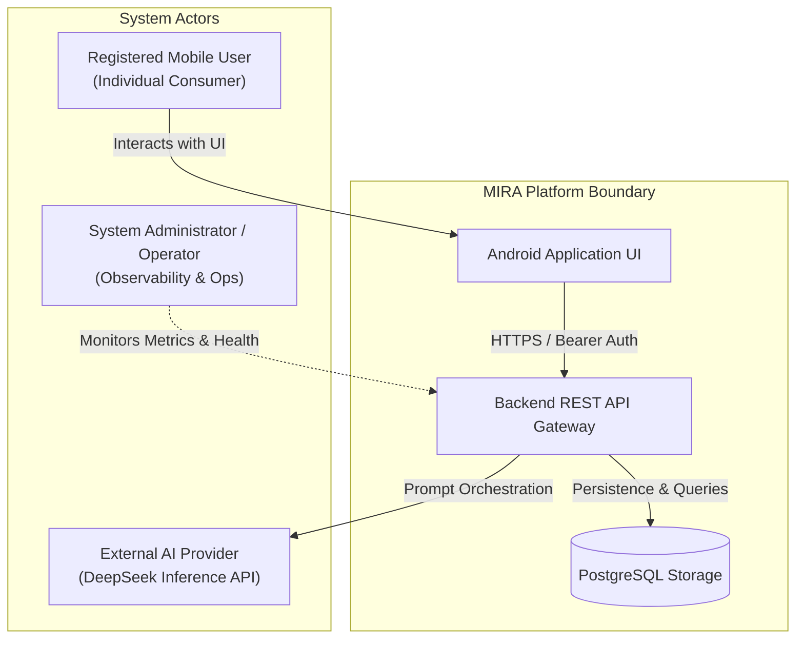

# MIRA — Product Requirements Specification (PRS)

| Attribute | Value |
| :--- | :--- |
| **Document ID** | MIRA-PRS-001 |
| **Classification** | Internal Engineering Specification |
| **Status** | Approved Baseline |
| **Version** | 1.0.0 |
| **Last Updated** | 2026-10-11 |
| **Author / Lead** | Bryan / MIRA Architecture Team |
| **Target Audience** | Engineering, Product, Quality Assurance |

---

## Document Revision History

| Version | Date | Author | Description of Changes |
| :--- | :--- | :--- | :--- |
| 0.1.0 | 2026-10-10 | Architecture Team | Draft baseline specification of functional and non-functional requirements. |
| 1.0.0 | 2026-10-11 | Bryan | Enterprise standardization: added document control block, formal traceability matrix, enhanced failure recovery FRs, and explicit MVP scope boundaries. |

---

## 1. Scope & System Objectives

This specification defines the functional requirements (FRs), non-functional requirements (NFRs), and operational acceptance criteria for the Minimum Viable Product (MVP) release of **MIRA** (**M**emory-**I**nformed **R**esponse **A**gent).

### 1.1 In-Scope Capabilities (MVP Release)
* Secure account registration and authentication via email and password.
* Dual-token session lifecycle (short-lived access tokens + revocable, rotating refresh tokens).
* Multi-session conversation management (create, list, retrieve, delete).
* Real-time conversational text exchange with an external LLM via an authenticated backend gateway.
* Bounded retry mechanics with client-supplied idempotency tokens.
* Persistent communication-style profile extraction, validation, and optimistic concurrency merging.
* Comprehensive user memory governance (inspect, edit, toggle, and purge).
* Strict multi-tenant account and resource data isolation.
* Automated integration test suites verifying data integrity without requiring live AI provider charges.

### 1.2 Explicit Out-of-Scope Capabilities (Deferred)
* Pre-training, fine-tuning, or hosting on-premise foundation models.
* Extraction or storage of biographical, personal knowledge, or financial data.
* Direct device-to-provider API communication.
* Public sharing or multi-user collaborative conversation sessions.
* Multimodal attachment processing (PDF and image question-answering are deferred to Phase 2).

---

## 2. System Stakeholders & User Personas

* **Registered User:** Primary consumer operating the native Android application. Owns distinct conversations, messages, sessions, and a personalized style profile.
* **External AI Provider (DeepSeek):** Downstream stateless inference engine consumed by the backend via secure server-side credentials.
* **System Operator:** Responsible for backend service deployment, environment variable configuration, schema migrations, and log monitoring.

---

## 3. Functional Requirements (FR)

### 3.1 Authentication & Session Management

#### FR-001: Account Registration
* **Description:** The system shall allow a new user to create an account by submitting a valid email address and password.
* **Acceptance Criteria:**
  1. Emails must be validated and normalized (lowercase, trimmed) prior to storage.
  2. Duplicate normalized emails must be rejected with an appropriate client error (`409 Conflict` or generic validation error) without leaking sensitive database internals.
  3. Passwords must be hashed using a modern, adaptive hashing algorithm (Argon2id or bcrypt with appropriate cost factor) before database storage. Plaintext passwords must never be stored, logged, or serialized.
  4. Successful registration creates exactly one user record and returns initial authentication credentials.

#### FR-002: User Authentication & Token Issuance
* **Description:** The system shall authenticate registered users using email and password, issuing dual-token credentials.
* **Acceptance Criteria:**
  1. Successful authentication issues a short-lived access token (e.g., 15 minutes) and a long-lived refresh token.
  2. Invalid login attempts return a uniform authentication failure (`401 Unauthorized`) without revealing whether the email or password was the cause.
  3. Refresh tokens must be cryptographically random strings, hashed before storage in the database, and associated with a specific user session.
  4. Submitting a valid refresh token atomically rotates the refresh token (invalidates predecessor, issues a new successor) and returns a new access token.
  5. Logout revokes the specific session's refresh token immediately on the backend.

---

### 3.2 Conversation & Messaging Subsystem

#### FR-003: Conversation Management
* **Description:** The system shall allow authenticated users to create, list, inspect, and delete distinct conversation threads.
* **Acceptance Criteria:**
  1. An authenticated user can create a new conversation with an optional title.
  2. A user can fetch a paginated list of their conversations sorted by last update time descending.
  3. Deleting a conversation removes the conversation record and cascades to all its associated messages.
  4. Deleting a conversation does **not** alter or delete the user's persistent communication-style profile.
  5. Users cannot inspect, list, modify, or delete conversations belonging to any other user.

#### FR-004: Text Messaging & AI Orchestration
* **Description:** The system shall accept user text prompts, persist them, coordinate AI provider inference, and persist the resulting assistant response.
* **Acceptance Criteria:**
  1. Requests must enforce message length limits (e.g., non-empty, max 4,000 characters).
  2. Every message submission must include an `Idempotency-Key` header scoped to the user and operation.
  3. User messages are persisted immediately upon validation before contacting the external AI provider.
  4. Assistant responses follow an explicit lifecycle state: `PENDING`, `COMPLETED`, `FAILED`, or `UNKNOWN`.
  5. If an AI provider request times out or returns an unresolvable network error, the response state transitions to `UNKNOWN`, preserving attempt audit records without deleting the user's message.

#### FR-005: Idempotent Retries
* **Description:** The system shall allow client retries of failed or unresolved message generation attempts without generating duplicate user messages.
* **Acceptance Criteria:**
  1. Resubmitting an identical request with the same `Idempotency-Key` returns the existing response or in-flight processing status.
  2. Reusing an existing `Idempotency-Key` with a different request payload is rejected with `409 Conflict`.
  3. A retry executes against the existing logical response record, tracking the new attempt independently in `AI_PROCESSING_ATTEMPT`.
  4. Total retry attempts are strictly bounded by server configuration to prevent runaway provider costs.

---

### 3.3 Communication-Style Memory Subsystem

#### FR-006: Persistent Style Profile Retrieval
* **Description:** The system shall maintain an independent, persistent communication-style profile per user account.
* **Acceptance Criteria:**
  1. A user account is associated with at most one active `USER_STYLE_PROFILE` record.
  2. Authenticated users can retrieve their current profile schema, active preferences, and version integer.
  3. When memory is enabled, the backend serializes the profile into advisory system prompts for new chat generation.
  4. If memory is disabled by the user, the profile is strictly omitted from AI context assembly.

#### FR-007: Candidate Extraction & Eligibility Gate
* **Description:** The system shall extract candidate style preferences only from successfully persisted conversations.
* **Acceptance Criteria:**
  1. Memory extraction is triggered **only** after an assistant response reaches `COMPLETED` status.
  2. In-flight (`PENDING`), failed (`FAILED`), or unresolved (`UNKNOWN`) responses are strictly ineligible for extraction.
  3. Extraction parses conversational signals against a strict schema (e.g., `explanation_depth`, `tone`, `examples`, `formatting`).
  4. Ephemeral task instructions (e.g., *"Make this specific summary short"*) are classified as context-specific and discarded from persistent memory.

#### FR-008: Hybrid Persistence & Conflict Resolution
* **Description:** The system shall merge approved memory candidates into the persistent profile using a hybrid policy.
* **Acceptance Criteria:**
  1. Explicit durable preferences (e.g., *"Always explain concepts from first principles"*) are validated and merged automatically.
  2. Inferred preferences require repeated evidence or explicit user confirmation.
  3. Newer user corrections and manual edits always take precedence over older inferred candidates.
  4. Profile updates must specify `expectedVersion` and execute via optimistic concurrency control (OCC). Version mismatches are rejected with `409 Conflict`.

#### FR-009: User Memory Governance (Edit, Toggle, Delete)
* **Description:** The system shall provide comprehensive user controls to inspect, manually edit, toggle, or purge their style memory.
* **Acceptance Criteria:**
  1. Users can manually overwrite any profile attribute via `PUT /api/v1/memory/style`.
  2. Users can toggle memory active status via `PATCH /api/v1/memory/style/settings`.
  3. Users can purge their memory via `DELETE /api/v1/memory/style`.
  4. Purging memory increments/invalidates the generation counter, guaranteeing that pending background extraction tasks cannot resurrect deleted data.

---

### 3.4 Cross-Cutting & Security Requirements

#### FR-010: Strict Data Isolation (Authorization)
* **Description:** The system shall enforce server-side resource ownership checks across all endpoints.
* **Acceptance Criteria:**
  1. The authenticated principal (from the verified access token) is the sole authority for data scoping.
  2. Client-provided `user_id` fields in request bodies or query parameters are never trusted for authorization.
  3. Attempting to access or mutate another user's conversation, message, or profile returns `404 Not Found` (to prevent IDOR enumeration) or `403 Forbidden`.

#### FR-011: Uniform Error Formatting
* **Description:** The API shall return deterministic, structured JSON errors for all failure modes.
* **Acceptance Criteria:**
  1. Error responses conform to the standard structure containing `code`, `message`, `requestId`, and optional `details`.
  2. Internal stack traces, raw SQL queries, and third-party API keys are never included in error bodies.
  3. Client applications can unambiguously categorize recoverable vs. non-recoverable errors based on HTTP status and error codes.

---

## 4. Non-Functional Requirements (NFR)

### NFR-001: Security & Confidentiality
* **NFR-001.1:** All network traffic between Android clients and the backend must enforce TLS 1.3 (HTTPS).
* **NFR-001.2:** Third-party AI provider credentials (`DEEPSEEK_API_KEY`) and database passwords must reside strictly in server environment variables and never be included in client binaries or source control.
* **NFR-001.3:** Passwords must be hashed using Argon2id or bcrypt. Refresh tokens must be hashed (SHA-256) at rest.

### NFR-002: Privacy & Data Minimization
* **NFR-002.1:** The memory subsystem must strictly restrict its domain to communication-style preferences. Extraction prompts must explicitly instruct models to omit biographical, financial, health, or political data.
* **NFR-002.2:** Server-side application logs must never record raw user prompt text, full AI response payloads, authentication tokens, or passwords.

### NFR-003: Reliability & Fault Isolation
* **NFR-003.1:** Outages or network timeouts from the external AI provider must not corrupt existing conversation history, truncate user messages, or crash the backend application.
* **NFR-003.2:** Database updates spanning multiple tables (e.g., token rotation, message + response creation) must execute within atomic transactional boundaries (`@Transactional`).

### NFR-004: Performance & Latency
* **NFR-004.1:** Local backend API operations (authentication, conversation listing, message history retrieval) shall return within 200 ms under nominal load (p95).
* **NFR-004.2:** External AI generation requests shall apply a strict connection timeout of 5 seconds and read timeout of 30 seconds to prevent thread starvation.

### NFR-005: Maintainability & Modularity
* **NFR-005.1:** The backend must be organized as a modular monolith with strictly isolated domain packages (`auth`, `chat`, `memory`, `ai`, `common`).
* **NFR-005.2:** Provider integration must depend on an abstracted interface (`AIProvider`) to permit drop-in provider replacement or mock testing without modifying core chat logic.

### NFR-006: Verifiability & Testability
* **NFR-006.1:** 100% of core business logic (authorization, memory merge policies, OCC version checks, token rotation) must be verifiable via automated unit and integration tests without active internet connectivity or paid API tokens.
* **NFR-006.2:** Database integration tests must run against real PostgreSQL instances via Testcontainers.

---

## 5. Requirements Traceability Matrix (RTM)

| Requirement ID | Domain Area | Architecture Reference | API Endpoint | Verification Test Suite |
| :--- | :--- | :--- | :--- | :--- |
| **FR-001** | Account Registration | `02-architecture.md#4.1` | `POST /api/v1/auth/register` | `AuthIntegrationTest` |
| **FR-002** | Auth & Session | `02-architecture.md#2.2` | `POST /api/v1/auth/login`, `/refresh` | `SessionLifecycleTest` |
| **FR-003** | Conversation Mgmt | `02-architecture.md#4.2` | `GET`, `POST`, `DELETE /conversations` | `ConversationSecurityTest` |
| **FR-004** | Chat Orchestration | `02-architecture.md#2.1` | `POST /conversations/{id}/messages` | `ChatOrchestrationTest` |
| **FR-005** | Idempotent Retries | `02-architecture.md#2.1` | `POST /conversations/{id}/messages` | `IdempotencyConcurrencyTest` |
| **FR-006** | Profile Retrieval | `02-architecture.md#4.3` | `GET /api/v1/memory/style` | `MemoryProfileTest` |
| **FR-007** | Memory Gate | `05-memory-lifecycle.md#5.7` | Internal Service Boundary | `MemoryEligibilityTest` |
| **FR-008** | Memory Merging (OCC)| `05-memory-lifecycle.md#6` | `PUT /api/v1/memory/style` | `MemoryConflictResolutionTest` |
| **FR-009** | Memory Governance | `05-memory-lifecycle.md#9` | `PATCH`, `DELETE /memory/style` | `MemoryDeletionRaceTest` |
| **FR-010** | Data Isolation | `06-security-and-privacy.md#5`| All Endpoints | `CrossAccountSecurityTest` |
| **FR-011** | Error Formatting | `04-api-contract.md#7` | Global Exception Handler | `ApiErrorContractTest` |
| **NFR-001** | Transport & Key Sec | `06-security-and-privacy.md#7`| Server Configuration | `SecurityHeadersTest` |
| **NFR-002** | Privacy Minimization| `06-security-and-privacy.md#9`| Memory Validation Engine | `MemoryPrivacyAuditTest` |
| **NFR-003** | Fault Isolation | `02-architecture.md#8` | Provider Abstraction Layer | `ProviderFailureRecoveryTest` |
| **NFR-006** | Testability | `07-testing-strategy.md#2`| Maven Build Verification | `CI Pipeline / Testcontainers` |