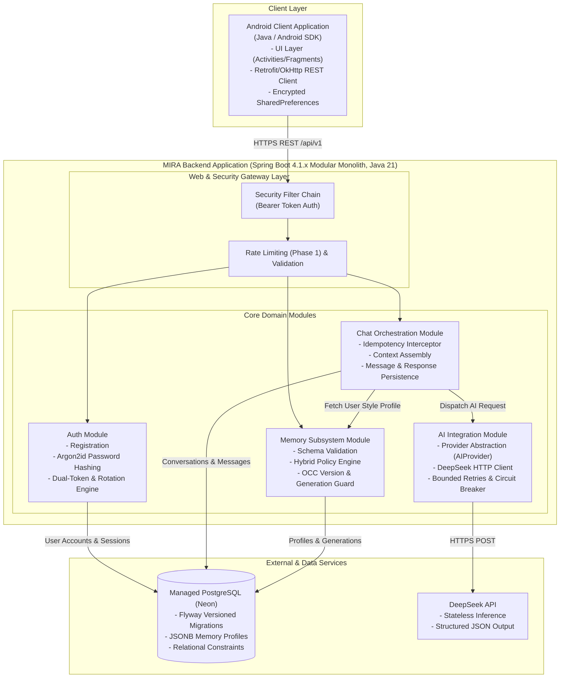
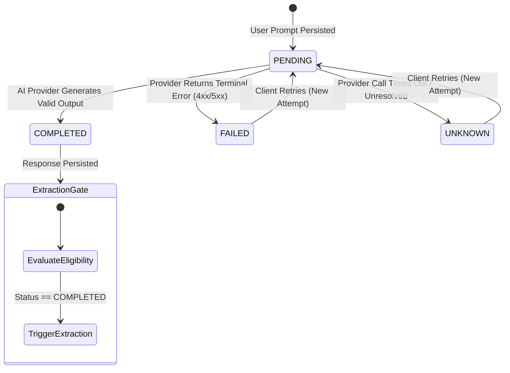
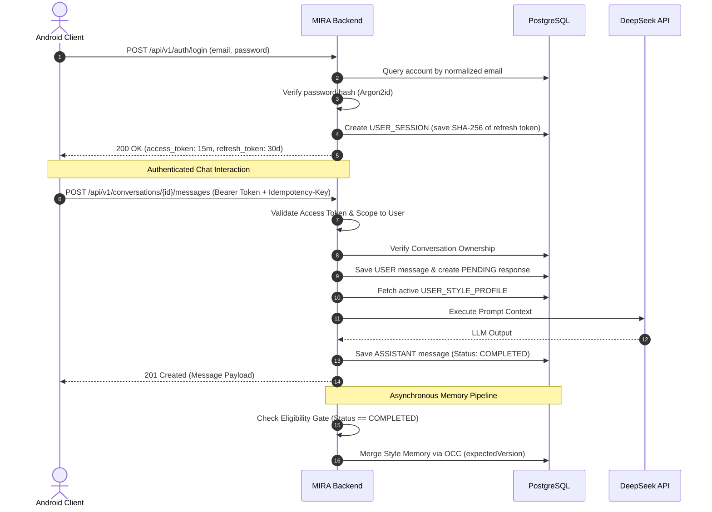

# MIRA — System Architecture Specification

| Attribute | Value |
| :--- | :--- |
| **Document ID** | MIRA-ARC-001 |
| **Classification** | Internal Engineering Specification |
| **Status** | Approved Baseline |
| **Version** | 1.2.0 |
| **Last Updated** | 2026-10-23 |
| **Author / Lead** | Bryan / MIRA Architecture Team |
| **Target Audience** | Software Engineers, Solution Architects, DevOps |

---

## Document Revision History

| Version | Date | Author | Description of Changes |
| :--- | :--- | :--- | :--- |
| 0.1.0 | 2026-10-10 | Architecture Team | Initial modular monolith architectural design and draft component definitions. |
| 1.0.0 | 2026-10-11 | Bryan | Enterprise standardization: integrated response lifecycle state machine, session rotation models, message retry semantics, and unified all pending draft updates. |
| 1.1.0 | 2026-10-21 | Bryan | Reconciled runtime versions, physical package layout, refresh-token rotation mechanics, and implementation status with the delivered backend. |
| 1.2.0 | 2026-10-23 | Bryan | Updated implementation status table to reflect completed backend chat core, response lifecycle, idempotency, bounded retries, and MockAIProvider. |

---

## 1. Architectural Philosophy & Strategy

MIRA adopts a **Modular Monolith** architecture pattern. 

### Why a Modular Monolith?
For an early-stage system, distributed microservices, message queues (e.g., Kafka, RabbitMQ), and distributed caches introduce severe operational overhead, distributed transaction hazards, and network latency without providing tangible scaling benefits.

Instead, MIRA enforces strict modularity at the application packaging boundary:
* **Single Deployment Unit:** Deployed as an executable Spring Boot 4.1.x fat JAR on Java 21.
* **Domain Isolation:** Service interfaces, DTO boundaries, and repository ownership queries keep modules decoupled. The current layer-first layout relies on these contracts rather than strict package-private enforcement; visibility can be tightened during a future feature-package refactor.
* **Unified ACID Persistence:** Modules share an enterprise-grade managed PostgreSQL instance, ensuring atomic state transitions without two-phase commits.
* **Extensibility:** Modules interact via clearly defined service interfaces, enabling clean future extraction into microservices if specific scale invariants demand it.



---

## 2. Core Subsystem Modules

### 2.1 Authentication & Session Management Module (`auth` domain)
* **Primary Scope:** Account creation, password hashing, credential verification, and token session lifecycles.
* **Core Responsibilities:**
  * Validate normalized email identity and enforce database uniqueness.
  * Execute adaptive password hashing using Argon2id/bcrypt.
  * Issue short-lived 15-minute HS256 JWT access tokens.
  * Issue cryptographically random, revocable refresh tokens.
  * Store only SHA-256 hashes of refresh tokens in the `USER_SESSION` table, and retain an append-only issuance/consumption audit trail in `REFRESH_TOKEN_HISTORY`.
  * Enforce atomic single-use refresh token rotation: using a valid refresh token yields a new token, marks the presented token consumed, and updates the session's current token hash in place.
  * Detect refresh token reuse (potential token theft) and immediately revoke the implicated session.

### 2.2 Chat Orchestration Module (`chat` domain)
* **Primary Scope:** Conversation management, message persistence, context aggregation, and interaction orchestration.
* **Core Responsibilities:**
  * Enforce server-side ownership: verify that the authenticated caller owns the target conversation before any read or write.
  * Intercept requests with `Idempotency-Key` headers to prevent duplicate message dispatch or duplicate AI invocations.
  * Persist incoming user messages immediately to ensure conversation state is never lost even if subsequent network calls fail.
  * Query the `Memory Module` for active style preferences and serialize them into advisory system context.
  * Retrieve the latest conversation history within bounded context limits (e.g., last 10 messages).
  * Record and track the logical assistant response and its individual processing attempts.

### 2.3 Memory Subsystem Module (`memory` domain)
* **Primary Scope:** Style memory extraction, validation, conflict resolution, versioning, and user governance.
* **Core Responsibilities:**
  * Manage persistent `USER_STYLE_PROFILE` records.
  * Gate extraction eligibility: only trigger memory extraction when a logical assistant response reaches `COMPLETED` status.
  * Execute schema validation on candidate preferences (allow-listing fields and enum values).
  * Apply the **Hybrid Memory Persistence Policy**: automatically persist explicit durable statements; hold ambiguous inferred preferences for confirmation; discard ephemeral task instructions.
  * Enforce **Optimistic Concurrency Control (OCC)** using an incremental `version` field to block stale asynchronous extraction updates from overwriting newer user changes.
  * Enforce **Generation Tracking** to ensure that purged style profiles cannot be resurrected by delayed background tasks.

### 2.4 AI Integration Module (`ai` domain)
* **Primary Scope:** Third-party LLM communication, request assembly, timeout management, and response normalization.
* **Core Responsibilities:**
  * Implement an abstracted provider interface:
    ```java
    public interface AIProvider {
        AIResponse generate(AIRequest request) throws AIProviderException;
    }
    ```
  * Maintain all DeepSeek API credentials on the server, injecting them via environment variables (`DEEPSEEK_API_KEY`).
  * Enforce bounded HTTP client connection (5s) and socket read (30s) timeouts.
  * Map provider-specific HTTP and JSON errors into normalized internal domain exceptions.
  * Facilitate deterministic local testing by providing mock implementations (`MockAIProvider`) that run without internet access or financial cost.

### 2.5 Physical Package Layout

The current implementation uses a **layer-first** package layout under `com.mira.mira_backend`. Domain isolation is maintained through service boundaries, repository ownership queries, and DTO contracts rather than package-private feature modules:

| Package | Responsibility |
| :--- | :--- |
| `config` | Spring Security filter chain, JWT encoder/decoder, password encoder |
| `controller` | REST endpoints (`AuthController`, `MeController`) |
| `dto` | Java records for request/response payloads |
| `entity` | JPA entities (`UserAccount`, `UserSession`, `RefreshTokenHistory`, `Conversation`) |
| `exception` | `@RestControllerAdvice` and domain exception mapping |
| `repository` | Spring Data JPA repositories and ownership/locking queries |
| `security` | REST authentication entry point and access-denied handler |
| `service` | Authentication, token rotation, account, and refresh-token services |

> [!NOTE]
> The original architecture targeted feature packages (`com.mira.auth`, `com.mira.chat`, `com.mira.memory`, `com.mira.ai`). The delivered scaffold uses the layer-first layout above. This is a packaging difference, not a change to the modular-boundary intent. A feature-package refactor can be performed later without changing the API or schema; it is not required for the MVP.
>
> Phase 1 will add a narrow `com.mira.mira_backend.ai` package for the `AIProvider` abstraction and provider implementations. This exception keeps provider-specific code out of the generic service layer; the remaining packages stay layer-first.

---

## 3. Message Processing & Failure Semantics

When a user submits a prompt, the system must navigate asynchronous network interactions, potential timeouts, and duplicate submissions while maintaining bulletproof data integrity.

### 3.1 Logical Response Lifecycle State Machine



* `PENDING`: Initial state. The user message is saved, the logical assistant response record is created, and the backend is processing or awaiting provider output.
* `COMPLETED`: Terminal success. A valid, complete assistant response has been received, sanitized, and stored.
* `FAILED`: Terminal attempt failure. The provider explicitly returned a deterministic error (e.g., quota exceeded, content violation).
* `UNKNOWN`: Unresolved outcome. The HTTP client timed out after dispatching the request. The backend cannot confirm whether DeepSeek processed the message or not.

> [!WARNING]
> **Timeout Ambiguity Rule:**
> A network timeout must **never** be assumed to mean the provider did not execute. MIRA records an `UNKNOWN` attempt outcome rather than reporting an outright failure, preventing erroneous assumptions about downstream state.

### 3.2 Bounded Retry & Idempotency Rules
1. **Stable Response Identity:** A retry operation references the existing logical response UUID. It does **not** create a duplicate user message or a second assistant response entity.
2. **Attempt Tracking:** Each execution is recorded as an independent `AI_PROCESSING_ATTEMPT` record with its own attempt number, timestamp, and outcome.
3. **Extraction Gate:** Memory extraction is strictly blocked from running on `PENDING`, `FAILED`, or `UNKNOWN` responses. Extraction is only permitted on `COMPLETED` responses.

---

## 4. Authentication & Session Security Architecture

MIRA protects user access through a defense-in-depth token strategy:



### 4.1 Token Specifications
* **Access Tokens:**
  * Lifetime: 15 minutes.
  * HS256 JWT signed with `MIRA_JWT_SECRET_BASE64` (a Base64-encoded secret of at least 32 bytes).
  * Claims: `iss`, `sub` (user ID), `iat`, `exp`, and `jti`. The session ID is returned in the login/refresh response body rather than embedded in the token.
  * Validated statelessly on every protected endpoint. Because access tokens are stateless, logout does not invalidate an already-issued access token; it remains valid until its 15-minute expiry while the refresh token is revoked immediately.
* **Refresh Tokens:**
  * Lifetime: 30 days from session creation. Rotation does **not** extend the absolute session expiry.
  * High-entropy cryptographically random string (32 bytes, Base64 URL-safe without padding).
  * Stored on the backend strictly as a SHA-256 hash.
  * `USER_SESSION.refresh_token_hash` holds the current token hash; `REFRESH_TOKEN_HISTORY` is an append-only audit trail of every issued token and its `consumed_at` timestamp.
  * Rotation runs in a single transaction: lock the session with `SELECT ... FOR UPDATE`, re-read history under the lock, mark the presented token consumed, update the session hash in place, append the successor history row, and issue a new access token.
  * Presenting a consumed history row is treated as replay. The implicated session is revoked before the request is rejected with `401 Unauthorized`.

---

## 5. Security & Boundary Controls

1. **Client Isolation:** The Android client communicates strictly with `/api/v1/*` over TLS 1.3. Direct client access to PostgreSQL or DeepSeek is architecturally impossible.
2. **Object-Level Authorization:** Handled via Spring Security and custom service assertions. Every database query filters by `user_id = authenticatedPrincipal.getId()`. Knowing another user's UUID yields a generic `404 Not Found`.
3. **Secret Isolation:**
   * `DEEPSEEK_API_KEY`, `SPRING_DATASOURCE_*`, and `MIRA_JWT_SECRET_BASE64` are injected exclusively via system environment variables.
   * Android APK builds contain only the public backend API URL.
4. **Log Sanitization:** Sensitive payload fields (passwords, tokens, raw conversational prompts) are excluded from server logs using structured logging filters.

---

## 6. Architectural Decision Records (ADR) Summary

The following formal decisions govern MIRA's architecture:

| ADR ID | Title | Status | Core Rationale |
| :--- | :--- | :--- | :--- |
| **ADR-001** | [Backend Technology Stack](./decisions/ADR-001-backend-stack.md) | Approved | Java 21 + Spring Boot 4.1.x modular monolith delivers enterprise stability, fast development, and strong typing. |
| **ADR-002** | [Memory Model & Concurrency](./decisions/ADR-002-memory-model.md) | Approved | Hybrid persistence policy with OCC versioning prevents stale background overwrites and protects user privacy. |
| **ADR-003** | [Multimodal Processing Phasing](./decisions/ADR-003-file-processing.md) | Approved | Defer image and PDF processing until the text chat, idempotency, and memory mechanics are verified; it is not part of Phase 1 or Phase 2. |

---

## 7. Current Implementation Status (2026-10-23)

| Capability | Status |
| :--- | :--- |
| Registration, login, JWT validation | Implemented |
| Refresh-token rotation, history, replay rejection | Implemented (session-scoped revocation) |
| Logout, `/me` | Implemented |
| Conversation entity, ownership query, cursor pagination query | Implemented |
| Conversation HTTP endpoints | Implemented (Backend) |
| Message persistence, response lifecycle, retries, idempotency | Implemented (Backend) |
| `AIProvider` abstraction and `MockAIProvider` | Implemented (Backend) |
| Live DeepSeek HTTP client | Phase 1 |
| Android authentication and chat client | Phase 1 (Scaffold complete, build working) |
| Style-memory governance and extraction | Phase 2 |

The active work breakdown is maintained in [10-phase-1-checklist.md](./10-phase-1-checklist.md).
