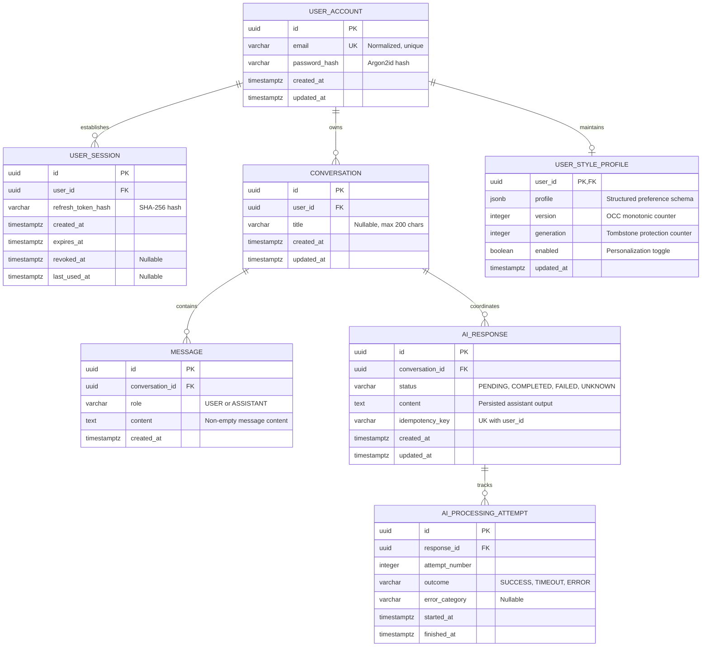

# MIRA — Domain Model & Relational Database Design

| Attribute | Value |
| :--- | :--- |
| **Document ID** | MIRA-DAT-001 |
| **Classification** | Internal Engineering Specification |
| **Status** | Approved Baseline |
| **Version** | 1.0.0 |
| **Last Updated** | 2026-10-11 |
| **Author / Lead** | Bryan / MIRA Data Engineering Team |
| **Database Engine** | PostgreSQL 15+ (Neon Managed Database) |
| **Migration Tool** | Flyway |

---

## Document Revision History

| Version | Date | Author | Description of Changes |
| :--- | :--- | :--- | :--- |
| 0.1.0 | 2026-10-10 | Data Team | Initial entity overview and relational draft schema. |
| 1.0.0 | 2026-10-11 | Bryan | Enterprise standardization: integrated visual Mermaid ERD, detailed DDL specifications, session tracking, attempt audits, and optimistic concurrency versioning. |

---

## 1. Architectural Principles & Data Invariants

1. **PostgreSQL as Single Source of Truth:** All persistent state (accounts, sessions, conversation threads, messages, and style profiles) resides authoritatively within PostgreSQL. The Android client operates purely as a secure consumer and presentation layer.
2. **Strict Foreign Key Constraints:** Referential integrity is strictly enforced at the database level rather than relying solely on application-level code.
3. **Data Ownership & Tenant Isolation:** Every user-owned record explicitly references `user_id`. Queries must scope by this key to prevent unauthorized cross-tenant data access.
4. **Decoupled Memory Life Cycle:** Deleting a conversation cascades to its messages, but **never** deletes the user's communication-style profile. Memory profile deletion must execute via an explicit, dedicated user action.
5. **Concurrency-Safe Mutations:** Concurrent style memory extractions and client edits are governed by Optimistic Concurrency Control (OCC) using an incremental `version` and `generation` counter.

---

## 2. Entity Relationship Diagram (ERD)



---

## 3. Relational Schema Specifications

### 3.1 `USER_ACCOUNT`
Maintains user identity and authentication credentials.

```sql
CREATE TABLE user_account (
    id UUID PRIMARY KEY DEFAULT gen_random_uuid(),
    email VARCHAR(254) NOT NULL,
    password_hash VARCHAR(255) NOT NULL,
    created_at TIMESTAMPTZ NOT NULL DEFAULT CURRENT_TIMESTAMP,
    updated_at TIMESTAMPTZ NOT NULL DEFAULT CURRENT_TIMESTAMP
);

CREATE UNIQUE INDEX idx_user_account_normalized_email 
    ON user_account (LOWER(TRIM(email)));
```
* **Integrity Rules:**
  * Emails are validated and normalized before indexing to prevent collision attacks (`user@example.com` vs `USER@example.com`).
  * `password_hash` stores the output of an adaptive password hasher (Argon2id or bcrypt).

---

### 3.2 `USER_SESSION`
Tracks active and historical mobile login sessions to support revocable refresh tokens and session rotation.

```sql
CREATE TABLE user_session (
    id UUID PRIMARY KEY DEFAULT gen_random_uuid(),
    user_id UUID NOT NULL REFERENCES user_account(id) ON DELETE CASCADE,
    refresh_token_hash VARCHAR(64) NOT NULL,
    created_at TIMESTAMPTZ NOT NULL DEFAULT CURRENT_TIMESTAMP,
    expires_at TIMESTAMPTZ NOT NULL,
    revoked_at TIMESTAMPTZ NULL,
    last_used_at TIMESTAMPTZ NULL
);

CREATE INDEX idx_user_session_user_lookup 
    ON user_session (user_id) 
    WHERE revoked_at IS NULL;

CREATE INDEX idx_user_session_hash 
    ON user_session (refresh_token_hash);
```
* **Integrity Rules:**
  * Only the SHA-256 hash of the cryptographically random refresh token is stored.
  * When a refresh token is rotated, `revoked_at` is updated atomically, and a new `user_session` record is inserted.
  * If a revoked token hash is presented, all active sessions for that `user_id` are revoked as a security countermeasure (refresh token reuse detection).

---

### 3.3 `CONVERSATION`
Represents an individual chat thread belonging to a user.

```sql
CREATE TABLE conversation (
    id UUID PRIMARY KEY DEFAULT gen_random_uuid(),
    user_id UUID NOT NULL REFERENCES user_account(id) ON DELETE CASCADE,
    title VARCHAR(200) NULL,
    created_at TIMESTAMPTZ NOT NULL DEFAULT CURRENT_TIMESTAMP,
    updated_at TIMESTAMPTZ NOT NULL DEFAULT CURRENT_TIMESTAMP
);

CREATE INDEX idx_conversation_user_updated 
    ON conversation (user_id, updated_at DESC);
```
* **Integrity Rules:**
  * Deleting a user cascades and deletes all associated conversations.
  * The compound index on `(user_id, updated_at DESC)` ensures efficient pagination of user conversation history.

---

### 3.4 `MESSAGE`
Stores chronological conversation turns.

```sql
CREATE TABLE message (
    id UUID PRIMARY KEY DEFAULT gen_random_uuid(),
    conversation_id UUID NOT NULL REFERENCES conversation(id) ON DELETE CASCADE,
    role VARCHAR(20) NOT NULL CHECK (role IN ('USER', 'ASSISTANT')),
    content TEXT NOT NULL,
    created_at TIMESTAMPTZ NOT NULL DEFAULT CURRENT_TIMESTAMP
);

CREATE INDEX idx_message_conversation_chronological 
    ON message (conversation_id, created_at ASC);
```
* **Integrity Rules:**
  * Role values are strictly constrained via a database `CHECK` constraint.
  * Message ordering is deterministically retrieved via `created_at ASC` (with `id ASC` as an absolute tie-breaker).

---

### 3.5 `AI_RESPONSE` & `AI_PROCESSING_ATTEMPT`
Decouples logical assistant responses from individual HTTP execution attempts, providing clean retry semantics and idempotency protection.

```sql
CREATE TABLE ai_response (
    id UUID PRIMARY KEY DEFAULT gen_random_uuid(),
    conversation_id UUID NOT NULL REFERENCES conversation(id) ON DELETE CASCADE,
    status VARCHAR(20) NOT NULL CHECK (status IN ('PENDING', 'COMPLETED', 'FAILED', 'UNKNOWN')),
    content TEXT NULL,
    idempotency_key VARCHAR(128) NOT NULL,
    created_at TIMESTAMPTZ NOT NULL DEFAULT CURRENT_TIMESTAMP,
    updated_at TIMESTAMPTZ NOT NULL DEFAULT CURRENT_TIMESTAMP
);

CREATE UNIQUE INDEX idx_ai_response_idempotency 
    ON ai_response (conversation_id, idempotency_key);

CREATE TABLE ai_processing_attempt (
    id UUID PRIMARY KEY DEFAULT gen_random_uuid(),
    response_id UUID NOT NULL REFERENCES ai_response(id) ON DELETE CASCADE,
    attempt_number INTEGER NOT NULL CHECK (attempt_number >= 1),
    outcome VARCHAR(20) NOT NULL CHECK (outcome IN ('SUCCESS', 'TIMEOUT', 'ERROR')),
    error_category VARCHAR(50) NULL,
    started_at TIMESTAMPTZ NOT NULL DEFAULT CURRENT_TIMESTAMP,
    finished_at TIMESTAMPTZ NULL
);

CREATE INDEX idx_ai_attempt_response 
    ON ai_processing_attempt (response_id, attempt_number ASC);
```
* **Integrity Rules:**
  * The unique constraint on `(conversation_id, idempotency_key)` guarantees that identical client submissions do not produce duplicate logical responses or duplicate provider executions.
  * Individual timeout occurrences are logged in `ai_processing_attempt` as `TIMEOUT`, transitioning the parent response to `UNKNOWN` until resolved by a retry.

---

### 3.6 `USER_STYLE_PROFILE`
Maintains persistent communication-style memory.

```sql
CREATE TABLE user_style_profile (
    user_id UUID PRIMARY KEY REFERENCES user_account(id) ON DELETE CASCADE,
    profile JSONB NOT NULL DEFAULT '{}'::jsonb,
    version INTEGER NOT NULL DEFAULT 1 CHECK (version >= 1),
    generation INTEGER NOT NULL DEFAULT 1 CHECK (generation >= 1),
    enabled BOOLEAN NOT NULL DEFAULT TRUE,
    updated_at TIMESTAMPTZ NOT NULL DEFAULT CURRENT_TIMESTAMP
);
```
* **Integrity Rules:**
  * `user_id` is both the primary key and a foreign key, enforcing a strict 1-to-1 relationship with `user_account`.
  * Optimistic Concurrency Control: Updates must include a `WHERE user_id = :userId AND version = :expectedVersion` predicate. On match, `version` is incremented by 1.
  * Tombstone / Generation Protection: When a user deletes their profile, `generation` is incremented, and `profile` is reset to `{}`. Background tasks carrying older generation numbers are automatically aborted to prevent resurrecting deleted memory.

---

## 4. Database Migrations & Versioning Strategy

All physical schema definitions are maintained using **Flyway** under `backend/src/main/resources/db/migration/`:

| Migration Script | Scope & Description |
| :--- | :--- |
| `V1__init_user_account.sql` | Create `user_account` and normalized email indices. |
| `V2__init_user_session.sql` | Create `user_session` table and hash lookup indices. |
| `V3__init_conversation_message.sql` | Create `conversation` and `message` tables with constraints. |
| `V4__init_ai_response_lifecycle.sql`| Create `ai_response` and `ai_processing_attempt` tables. |
| `V5__init_user_style_profile.sql` | Create `user_style_profile` table with JSONB and OCC constraints. |

> [!NOTE]
> Database migrations must be forward-compatible. Destructive migrations (e.g., dropping columns) must follow a multi-step expand-and-contract deployment pattern.