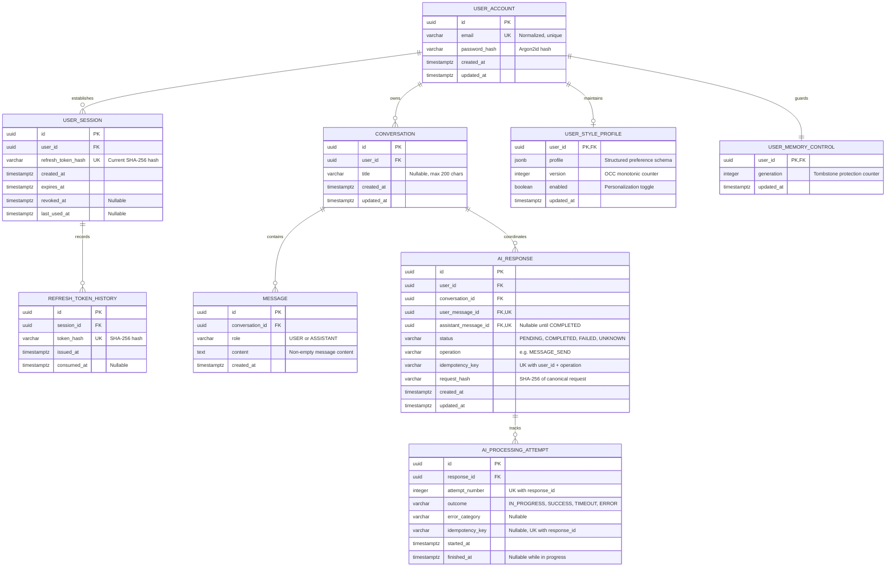

# MIRA — Domain Model & Relational Database Design

| Attribute | Value |
| :--- | :--- |
| **Document ID** | MIRA-DAT-001 |
| **Classification** | Internal Engineering Specification |
| **Status** | Approved Baseline |
| **Version** | 1.3.0 |
| **Last Updated** | 2026-10-26 |
| **Author / Lead** | Bryan / MIRA Data Engineering Team |
| **Database Engine** | PostgreSQL 15+ (Neon Managed Database; PostgreSQL 18 in Testcontainers) |
| **Migration Tool** | Flyway |

---

## Document Revision History

| Version | Date | Author | Description of Changes |
| :--- | :--- | :--- | :--- |
| 0.1.0 | 2026-10-10 | Data Team | Initial entity overview and relational draft schema. |
| 1.0.0 | 2026-10-11 | Bryan | Enterprise standardization: integrated visual Mermaid ERD, detailed DDL specifications, session tracking, attempt audits, and optimistic concurrency versioning. |
| 1.1.0 | 2026-10-21 | Bryan | Reconciled the documented schema with Flyway migrations V1–V8: refresh-token history, final `ai_response` shape, composite ownership FKs, and the separation of generation control from the style profile. |
| 1.2.0 | 2026-10-23 | Bryan | Reconciled migration baseline with Flyway V1–V9, adding `idempotency_key` and unique partial index `uq_ai_attempt_idempotency` to `ai_processing_attempt`. |
| 1.3.0 | 2026-10-26 | Bryan | Recorded Phase 2 usage of the existing `user_style_profile` and `user_memory_control` tables by the implemented governance service. No schema changes; migrations remain V1–V9. |

---

## 1. Architectural Principles & Data Invariants

1. **PostgreSQL as Single Source of Truth:** All persistent state (accounts, sessions, conversations, messages, AI responses, and style profiles) resides authoritatively within PostgreSQL. The Android client operates purely as a secure consumer and presentation layer.
2. **Strict Foreign Key Constraints:** Referential integrity is enforced at the database level rather than relying solely on application-level code.
3. **Data Ownership & Tenant Isolation:** Every user-owned record explicitly references `user_id`. Queries must scope by this key to prevent unauthorized cross-tenant data access.
4. **Decoupled Memory Life Cycle:** Deleting a conversation cascades to its messages and AI response records, but **never** deletes the user's communication-style profile. Memory profile deletion must execute via an explicit, dedicated user action.
5. **Concurrency-Safe Mutations:** Concurrent style-memory extractions and client edits are governed by Optimistic Concurrency Control (OCC) using an incremental `version`, while a durable `generation` counter in `user_memory_control` prevents deleted profiles from being resurrected.
6. **Token Auditability:** Only SHA-256 hashes of refresh tokens are stored. The session row holds the current hash; `refresh_token_history` preserves every issued hash and its consumption time for replay detection.
7. **Migrations Are Authoritative:** The DDL below reflects the consolidated state after Flyway migrations `V1`–`V9`. If this document and a migration disagree, the migration is the source of truth and this document must be corrected.

---

## 2. Entity Relationship Diagram (ERD)



> [!NOTE]
> `AI_RESPONSE.assistant_message_id` is the authoritative link to the delivered assistant text. There is no separate `content` column on `ai_response`; assistant content is stored in `MESSAGE`.

---

## 3. Relational Schema Specifications

### 3.1 `USER_ACCOUNT`
Maintains user identity and authentication credentials.

```sql
CREATE TABLE user_account (
    id UUID PRIMARY KEY DEFAULT gen_random_uuid(),
    email VARCHAR(254) NOT NULL,
    password_hash VARCHAR(255) NOT NULL,
    created_at TIMESTAMPTZ NOT NULL DEFAULT CURRENT_TIMESTAMP,
    updated_at TIMESTAMPTZ NOT NULL DEFAULT CURRENT_TIMESTAMP
);

CREATE UNIQUE INDEX uq_user_account_email_normalized
    ON user_account (LOWER(TRIM(email)));
```
* **Integrity Rules:**
  * Emails are validated and normalized before indexing to prevent collision attacks (`user@example.com` vs `USER@example.com`).
  * `password_hash` stores the output of an adaptive password hasher (Argon2id in the current implementation).
  * The unique index name `uq_user_account_email_normalized` is used by the service layer to distinguish duplicate-email errors from unrelated integrity failures.

---

### 3.2 `USER_SESSION` & `REFRESH_TOKEN_HISTORY`
Tracks login sessions and provides replay detection for rotating refresh tokens.

```sql
CREATE TABLE user_session (
    id UUID PRIMARY KEY DEFAULT gen_random_uuid(),
    user_id UUID NOT NULL
        REFERENCES user_account(id) ON DELETE CASCADE,
    refresh_token_hash VARCHAR(64) NOT NULL,
    created_at TIMESTAMPTZ NOT NULL DEFAULT CURRENT_TIMESTAMP,
    expires_at TIMESTAMPTZ NOT NULL,
    revoked_at TIMESTAMPTZ NULL,
    last_used_at TIMESTAMPTZ NULL,

    CONSTRAINT ck_user_session_expiry
        CHECK (expires_at > created_at)
);

CREATE INDEX idx_user_session_user_id
    ON user_session (user_id);

CREATE INDEX idx_user_session_active
    ON user_session (user_id)
    WHERE revoked_at IS NULL;

CREATE UNIQUE INDEX uq_user_session_token_hash
    ON user_session (refresh_token_hash);

CREATE TABLE refresh_token_history (
    id UUID PRIMARY KEY DEFAULT gen_random_uuid(),
    session_id UUID NOT NULL
        REFERENCES user_session(id) ON DELETE CASCADE,
    token_hash VARCHAR(64) NOT NULL,
    issued_at TIMESTAMPTZ NOT NULL,
    consumed_at TIMESTAMPTZ NULL,

    CONSTRAINT uq_refresh_token_history_hash
        UNIQUE (token_hash),

    CONSTRAINT ck_refresh_token_history_consumed
        CHECK (consumed_at IS NULL OR consumed_at >= issued_at)
);

CREATE INDEX idx_refresh_token_history_session
    ON refresh_token_history (session_id);
```
* **Integrity Rules:**
  * Only the SHA-256 hash of a refresh token is stored. Plaintext tokens are never persisted.
  * `user_session.refresh_token_hash` holds the **current** token for the session. On rotation, the hash is updated in place; the previous hash remains in `refresh_token_history` with `consumed_at` set.
  * `refresh_token_history.token_hash` is globally unique; a hash cannot identify two sessions.
  * If a consumed token is presented again, the transaction revokes the implicated session, and the token endpoint returns `401 Unauthorized`.
  * V7 introduced `uq_user_session_token_hash`; the older non-unique `idx_user_session_token_hash` from V2 is now redundant and may be dropped in a future cleanup migration.

---

### 3.3 `CONVERSATION`
Represents an individual chat thread belonging to a user.

```sql
CREATE TABLE conversation (
    id UUID PRIMARY KEY DEFAULT gen_random_uuid(),
    user_id UUID NOT NULL
        REFERENCES user_account(id) ON DELETE CASCADE,
    title VARCHAR(200) NULL,
    created_at TIMESTAMPTZ NOT NULL DEFAULT CURRENT_TIMESTAMP,
    updated_at TIMESTAMPTZ NOT NULL DEFAULT CURRENT_TIMESTAMP,

    CONSTRAINT uq_conversation_id_user
        UNIQUE (id, user_id)
);

CREATE INDEX idx_conversation_user_updated
    ON conversation (user_id, updated_at DESC);
```
* **Integrity Rules:**
  * Deleting a user cascades to all associated conversations.
  * The compound index on `(user_id, updated_at DESC)` supports cursor pagination of conversation history.
  * `uq_conversation_id_user` provides a composite key target for child tables that must prove both conversation and user ownership.

---

### 3.4 `MESSAGE`
Stores chronological conversation turns.

```sql
CREATE TABLE message (
    id UUID PRIMARY KEY DEFAULT gen_random_uuid(),
    conversation_id UUID NOT NULL
        REFERENCES conversation(id) ON DELETE CASCADE,
    role VARCHAR(20) NOT NULL,
    content TEXT NOT NULL,
    created_at TIMESTAMPTZ NOT NULL DEFAULT CURRENT_TIMESTAMP,

    CONSTRAINT ck_message_role
        CHECK (role IN ('USER', 'ASSISTANT')),

    CONSTRAINT ck_message_content_nonempty
        CHECK (LENGTH(TRIM(content)) > 0),

    CONSTRAINT uq_message_id_conversation
        UNIQUE (id, conversation_id)
);

CREATE INDEX idx_message_conversation_created
    ON message (conversation_id, created_at ASC, id ASC);
```
* **Integrity Rules:**
  * Role values are constrained to `USER` and `ASSISTANT`.
  * Message content cannot be empty or whitespace-only.
  * Ordering is deterministic via `created_at ASC, id ASC`.
  * `uq_message_id_conversation` supports composite FKs from `ai_response`, ensuring a referenced message belongs to the same conversation.

---

### 3.5 `AI_RESPONSE` & `AI_PROCESSING_ATTEMPT`
Decouples a logical assistant response from individual provider execution attempts, providing clean retry semantics and idempotency protection.

```sql
CREATE TABLE ai_response (
    id UUID PRIMARY KEY DEFAULT gen_random_uuid(),
    user_id UUID NOT NULL,
    conversation_id UUID NOT NULL,
    user_message_id UUID NOT NULL,
    assistant_message_id UUID NULL,
    status VARCHAR(20) NOT NULL DEFAULT 'PENDING',
    operation VARCHAR(40) NOT NULL DEFAULT 'MESSAGE_SEND',
    idempotency_key VARCHAR(128) NOT NULL,
    request_hash VARCHAR(64) NOT NULL,
    created_at TIMESTAMPTZ NOT NULL DEFAULT CURRENT_TIMESTAMP,
    updated_at TIMESTAMPTZ NOT NULL DEFAULT CURRENT_TIMESTAMP,

    CONSTRAINT fk_ai_response_conversation_user
        FOREIGN KEY (conversation_id, user_id)
        REFERENCES conversation (id, user_id)
        ON DELETE CASCADE,

    CONSTRAINT fk_ai_response_user_message
        FOREIGN KEY (user_message_id, conversation_id)
        REFERENCES message (id, conversation_id)
        ON DELETE CASCADE,

    CONSTRAINT fk_ai_response_assistant_message
        FOREIGN KEY (assistant_message_id, conversation_id)
        REFERENCES message (id, conversation_id)
        ON DELETE CASCADE,

    CONSTRAINT ck_ai_response_status
        CHECK (status IN ('PENDING', 'COMPLETED', 'FAILED', 'UNKNOWN')),

    CONSTRAINT ck_ai_response_assistant_message
        CHECK (
            (status = 'COMPLETED' AND assistant_message_id IS NOT NULL)
            OR
            (status <> 'COMPLETED' AND assistant_message_id IS NULL)
        ),

    CONSTRAINT uq_ai_response_user_message
        UNIQUE (user_message_id),

    CONSTRAINT uq_ai_response_idempotency
        UNIQUE (user_id, operation, idempotency_key)
);

CREATE UNIQUE INDEX uq_ai_response_assistant_message
    ON ai_response (assistant_message_id)
    WHERE assistant_message_id IS NOT NULL;

CREATE INDEX idx_ai_response_conversation_created
    ON ai_response (conversation_id, created_at ASC);

CREATE TABLE ai_processing_attempt (
    id UUID PRIMARY KEY DEFAULT gen_random_uuid(),
    response_id UUID NOT NULL
        REFERENCES ai_response(id) ON DELETE CASCADE,
    attempt_number INTEGER NOT NULL,
    outcome VARCHAR(20) NOT NULL,
    error_category VARCHAR(50) NULL,
    started_at TIMESTAMPTZ NOT NULL DEFAULT CURRENT_TIMESTAMP,
    finished_at TIMESTAMPTZ NULL,
    idempotency_key VARCHAR(128) NULL,

    CONSTRAINT ck_ai_attempt_number
        CHECK (attempt_number >= 1),

    CONSTRAINT ck_ai_attempt_outcome
        CHECK (outcome IN ('IN_PROGRESS', 'SUCCESS', 'TIMEOUT', 'ERROR')),

    CONSTRAINT ck_ai_attempt_finished
        CHECK (
            (outcome = 'IN_PROGRESS' AND finished_at IS NULL)
            OR
            (outcome <> 'IN_PROGRESS' AND finished_at IS NOT NULL)
        ),

    CONSTRAINT uq_ai_attempt_number
        UNIQUE (response_id, attempt_number)
);

CREATE UNIQUE INDEX uq_ai_attempt_idempotency
    ON ai_processing_attempt (response_id, idempotency_key)
    WHERE idempotency_key IS NOT NULL;
```
* **Integrity Rules:**
  * `uq_ai_response_idempotency` guarantees that a client key maps to exactly one logical response per user and operation.
  * `uq_ai_response_user_message` guarantees one logical response per user message.
  * A response may only be `COMPLETED` when `assistant_message_id` is set; non-completed responses must not reference an assistant message.
  * `request_hash` stores a canonical hash of the request payload so that key reuse with a different body can be rejected with `409 Conflict`.
  * Each execution is recorded independently in `ai_processing_attempt`; `IN_PROGRESS` rows have no `finished_at`, while terminal outcomes require one.
  * V7 added the partial unique index on `assistant_message_id` and dropped the duplicate non-unique attempt index. The unique constraint `uq_ai_attempt_number` remains the supporting index for attempt lookups.
  * V9 added the nullable `idempotency_key` column to `ai_processing_attempt` and the partial unique index `uq_ai_attempt_idempotency` to enforce that retry submissions with the same key map to the same attempt.

---

### 3.6 `USER_STYLE_PROFILE`
Maintains persistent communication-style memory.

```sql
CREATE TABLE user_style_profile (
    user_id UUID PRIMARY KEY
        REFERENCES user_account(id) ON DELETE CASCADE,
    profile JSONB NOT NULL DEFAULT '{}'::jsonb,
    version INTEGER NOT NULL DEFAULT 1,
    enabled BOOLEAN NOT NULL DEFAULT TRUE,
    updated_at TIMESTAMPTZ NOT NULL DEFAULT CURRENT_TIMESTAMP,

    CONSTRAINT ck_user_style_profile_object
        CHECK (jsonb_typeof(profile) = 'object'),

    CONSTRAINT ck_user_style_profile_version
        CHECK (version >= 1)
);
```
* **Integrity Rules:**
  * `user_id` is both the primary key and a foreign key, enforcing a strict 1-to-1 relationship with `user_account`.
  * OCC updates use `WHERE user_id = :userId AND version = :expectedVersion`; on match, `version` is incremented by 1.
  * The `profile` document must be a JSON object. Application-level validation restricts keys and enum values to the allow-list in [05-memory-lifecycle.md](./05-memory-lifecycle.md#31-allowed-fields--enum-values).
  * The profile table deliberately has **no** `generation` column. Generation state lives in `USER_MEMORY_CONTROL` so that it survives physical deletion of the profile row.
  * **Implementation status (Phase 2):** `StyleProfileService` provisions a profile row on first access (`version = 1`, `enabled = true`, empty JSONB object), validates replacement payloads against the allow-list, and applies OCC updates via the version precondition. Reads and mutations are exposed through `/api/v1/memory/style`.

---

### 3.7 `USER_MEMORY_CONTROL`
Provides durable tombstone protection for generation-based concurrency control.

```sql
CREATE TABLE user_memory_control (
    user_id UUID PRIMARY KEY
        REFERENCES user_account(id) ON DELETE CASCADE,
    generation INTEGER NOT NULL DEFAULT 1,
    updated_at TIMESTAMPTZ NOT NULL DEFAULT CURRENT_TIMESTAMP,

    CONSTRAINT ck_user_memory_control_generation
        CHECK (generation >= 1)
);
```
* **Integrity Rules:**
  * Exactly one control row exists per user. It is created before or alongside the first memory operation.
  * Purging memory increments `generation` under `SELECT ... FOR UPDATE` and deletes the profile row in the same transaction.
  * Background extraction jobs capture an immutable `expected_generation`; a commit is rejected if the current generation differs.
  * A control row is preserved even when the profile is deleted, so a delayed worker cannot resurrect purged preferences.
  * **Implementation status (Phase 2):** The purge endpoint locks the control row with `SELECT ... FOR UPDATE`, increments `generation`, and clears the profile in the same transaction. Background extraction workers that capture `expected_generation` are not implemented yet; see [11-phase-2-checklist.md](./11-phase-2-checklist.md).

---

## 4. Database Migrations & Versioning Strategy

All physical schema definitions are maintained using **Flyway** under `backend/src/main/resources/db/migration/`. The following migrations are applied in order:

| Migration Script | Scope & Description |
| :--- | :--- |
| `V1__init_user_account.sql` | Create `user_account` and the normalized-email unique index. |
| `V2__init_user_session.sql` | Create `user_session`, including expiry checks and active-session indices. |
| `V3__init_conversation_message.sql` | Create `conversation` and `message` with composite ownership keys, role/content checks, and chronological index. |
| `V4__init_ai_response_lifecycle.sql` | Create `ai_response` and `ai_processing_attempt` with lifecycle, idempotency, and attempt constraints. |
| `V5__init_user_style_profile.sql` | Create `user_style_profile` with JSONB object and version constraints. |
| `V6__init_user_memory_control.sql` | Create the durable `user_memory_control` generation table. |
| `V7__tighten_uniqueness_constraints.sql` | Make refresh-token hashes unique, make assistant-message links unique, and drop a duplicate attempt index. |
| `V8__add_refresh_token_history.sql` | Create `refresh_token_history` and backfill existing session token hashes. |
| `V9__add_attempt_idempotency.sql` | Add nullable `idempotency_key` column and partial unique index `uq_ai_attempt_idempotency` on `(response_id, idempotency_key)` to `ai_processing_attempt`. |

> [!NOTE]
> Database migrations must be forward-compatible. Destructive migrations (e.g., dropping columns) must follow a multi-step expand-and-contract deployment pattern. The redundant `idx_user_session_token_hash` index from V2 is retained for now; dropping it is a non-destructive cleanup candidate for a future migration.
