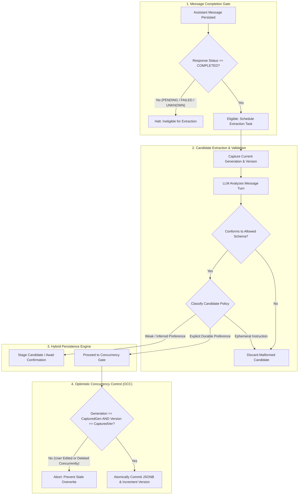
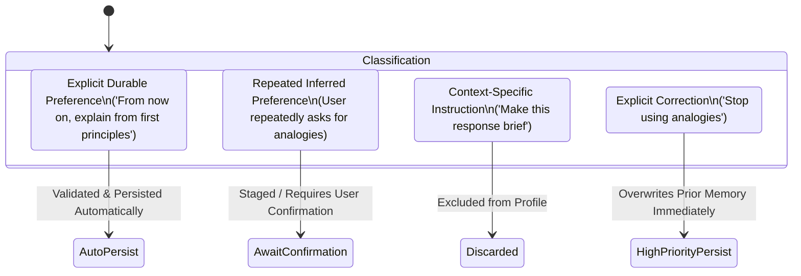
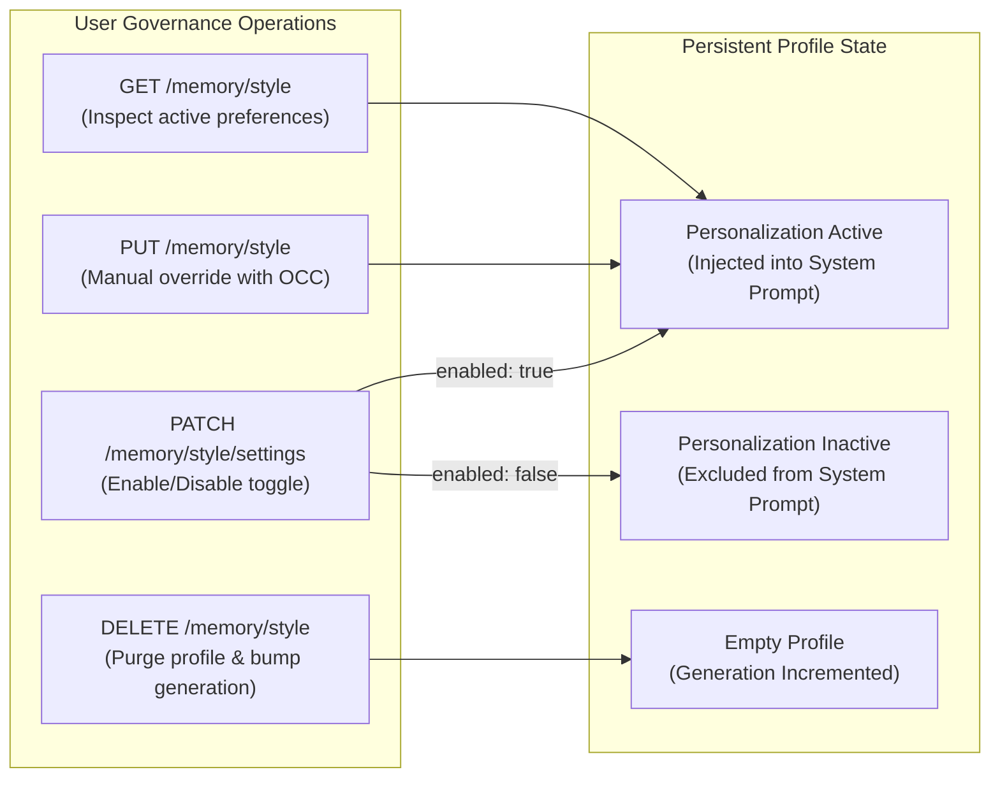

# MIRA — Communication-Style Memory Lifecycle Specification

| Attribute | Value |
| :--- | :--- |
| **Document ID** | MIRA-MEM-001 |
| **Classification** | Internal Engineering Specification |
| **Status** | Approved Baseline |
| **Version** | 1.0.0 |
| **Last Updated** | 2026-10-11 |
| **Author / Lead** | Bryan / MIRA Personalization & Memory Team |
| **Scope** | Persistent Communication-Style Preferences |

---

## Document Revision History

| Version | Date | Author | Description of Changes |
| :--- | :--- | :--- | :--- |
| 0.1.0 | 2026-10-10 | Memory Team | Initial memory scope, schema draft, and extraction lifecycle definition. |
| 1.0.0 | 2026-10-11 | Bryan | Enterprise standardization: integrated visual Mermaid extraction pipeline, eligibility gate specification, generation tombstone mechanics, and unified draft notes. |

---

## 1. Core Memory Axioms & Design Boundaries

The MIRA personalization engine is built upon five foundational axioms:

1. **Memory Informs, Never Defines:** The memory profile stores *communication style* preferences only. It never stores biographical facts, personal identifiers, health data, finances, or political stances.
2. **Current Request Dominance:** Immediate, explicit prompt instructions in an active conversation (e.g., *"Provide this specific answer in bullet points"*) **always** take precedence over historical style preferences.
3. **Manual Overrides Automated:** A direct user edit or deletion in profile settings **always** overrules and invalidates automated background model extractions.
4. **Extraction Decoupled from Ingestion:** Chat responses are delivered to users without waiting for memory extraction. Extraction runs asynchronously and never impacts chat latency or response availability.
5. **Strict Eligibility Gate:** Memory extraction is permitted **only** on messages associated with successfully persisted assistant responses in `COMPLETED` status.

---

## 2. Memory Extraction & Ingestion Pipeline



---

## 3. Communication-Style Profile Schema

The user's persistent style preferences are stored as a strictly validated JSONB document in the `USER_STYLE_PROFILE` table.

### 3.1 Allowed Fields & Enum Values

| Field Name | Type | Allowed Values | Semantic Definition |
| :--- | :--- | :--- | :--- |
| `explanation_depth` | String | `concise`, `balanced`, `detailed` | Preferred depth and breadth of technical explanations. |
| `tone` | String | `conversational`, `formal`, `academic` | Tone and stylistic register of the generated output. |
| `examples` | String | `prefer_concrete_examples`, `theory_first`, `no_strong_preference` | Whether to anchor concepts in concrete examples or abstract theory. |
| `formatting` | String | `structured`, `prose`, `bulleted_lists`, `no_strong_preference` | Structural layout of responses (markdown headings vs prose). |
| `teaching_sequence` | String | `principles_first`, `code_first`, `analogy_first`, `no_strong_preference` | Ordering of pedagogical presentation. |

### 3.2 Schema Validation Invariants
* Any candidate update containing unlisted keys or unlisted enum values is rejected outright.
* Missing fields are treated as `no_strong_preference` (unspecified) and fall back to default assistant behavior.
* The JSON document cannot contain nested executable code, markdown prompts, or free-form arbitrary text fields.

---

## 4. Candidate Classification & The Hybrid Persistence Policy

Candidate style attributes extracted from conversational turns are categorized according to evidence strength:



### 4.1 Candidate Taxonomy & Handling Rules

1. **Explicit Durable Preference:**
   * *User Utterance:* *"From now on, always give me concrete Java examples before explaining the theory."*
   * *Action:* Validated against the schema and merged into the active profile automatically.
2. **Context-Specific (Ephemeral) Instruction:**
   * *User Utterance:* *"Keep this specific response under two sentences."*
   * *Action:* Applied exclusively to the current prompt context; discarded from persistent memory.
3. **Inferred Preference:**
   * *User Utterance:* User asks for code snippets across two conversations without explicitly requesting a permanent rule.
   * *Action:* Staged as an unconfirmed candidate. Not persisted to the profile without explicit user review.
4. **Explicit User Correction:**
   * *User Utterance:* *"I don't want detailed formatting anymore; just use plain prose."*
   * *Action:* High-priority update. Overwrites historical preferences immediately.

---

## 5. Concurrency Controls & Race Condition Mitigations

Because memory extraction executes asynchronously, background tasks can finish **after** a user has manually updated their profile or deleted it entirely.

### 5.1 Optimistic Concurrency Control (OCC)
Every update transaction enforces atomic version checking:
```sql
UPDATE user_style_profile
SET profile = :updatedProfileJson,
    version = version + 1,
    updated_at = CURRENT_TIMESTAMP
WHERE user_id = :userId 
  AND version = :expectedVersion;
```
If the database record has been updated concurrently (i.e., `version != :expectedVersion`), zero rows are updated, and the background task discards its candidate rather than overwriting newer user preferences.

### 5.2 Generation Counter (Tombstone Protection Against Deletion Race)
When a user purges their memory via `DELETE /api/v1/memory/style`:
```sql
UPDATE user_style_profile
SET profile = '{}'::jsonb,
    generation = generation + 1,
    version = version + 1,
    updated_at = CURRENT_TIMESTAMP
WHERE user_id = :userId;
```
Background extraction jobs capture the `generation` number at the time they are dispatched. If `capturedGeneration < currentGeneration` upon persistence attempt, the extraction job is terminated. This guarantees that an in-flight background task cannot accidentally resurrect a deleted memory profile.

---

## 6. Memory Governance Operations

Users maintain complete sovereignty over their personalization data via standard API operations:



### 6.1 State Transitions
* **Inspecting Memory:** Returns the currently active preferences, version integer, and enabled state.
* **Editing Memory:** Manually replaces preferences with full schema validation; increments the version counter.
* **Toggling Memory:** Setting `enabled: false` immediately excludes the profile from all future AI prompt context assemblies without deleting the underlying preference configuration.
* **Purging Memory:** Completely resets the JSONB structure, increments the generation counter, and permanently aborts any pending asynchronous extraction workers.