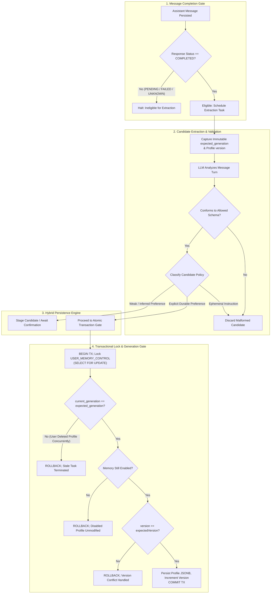
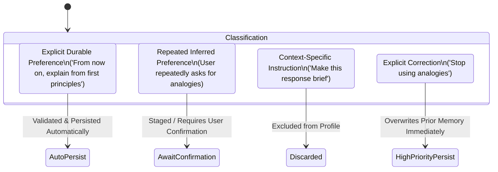
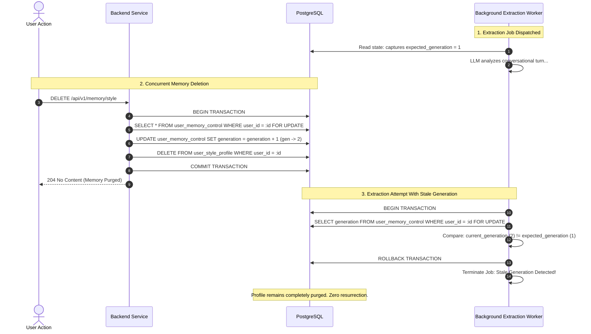

# MIRA — Communication-Style Memory Lifecycle Specification

| Attribute | Value |
| :--- | :--- |
| **Document ID** | MIRA-MEM-001 |
| **Classification** | Internal Engineering Specification |
| **Status** | Approved Baseline |
| **Version** | 1.3.0 |
| **Last Updated** | 2026-10-26 |
| **Author / Lead** | Bryan / MIRA Personalization & Memory Team |
| **Scope** | Persistent Communication-Style Preferences |

---

## Document Revision History

| Version | Date | Author | Description of Changes |
| :--- | :--- | :--- | :--- |
| 0.1.0 | 2026-10-10 | Memory Team | Initial memory scope, schema draft, and extraction lifecycle definition. |
| 1.0.0 | 2026-10-11 | Bryan | Enterprise standardization: integrated visual Mermaid extraction pipeline, eligibility gate specification, and generation tombstone mechanics. |
| 1.1.0 | 2026-10-11 | Bryan | Integrated durable `USER_MEMORY_CONTROL` generation table, atomic row-level locking deletion protocol, and robust deletion-race verification suite. |
| 1.2.0 | 2026-10-21 | Bryan | Added the delivery-phase status, confirmed the generation/profile table split against Flyway V5–V6, and clarified that this specification is the Phase 2 target. |
| 1.3.0 | 2026-10-26 | Bryan | Reconciled Phase 2 backend delivery: governance endpoints, allow-list validation, OCC conflict handling, and generation-guarded purge are implemented. Extraction, hybrid policy staging, prompt injection, Android UI, and MEM-TEST-01..07 remain pending. |

---

## Implementation Status (2026-10-26)

The durable schema and the backend governance surface are in place:

- `user_style_profile` (`V5`) stores the JSONB profile, `version`, and `enabled`.
- `user_memory_control` (`V6`) stores the durable `generation` tombstone counter.
- `MemoryController` and `StyleProfileService` implement:
  - `GET /api/v1/memory/style` with first-read provisioning (`enabled = true`, `version = 1`, empty profile).
  - `PUT /api/v1/memory/style` with allow-list validation and OCC (`409 version_conflict`).
  - `PATCH /api/v1/memory/style/settings` to toggle `enabled`.
  - `DELETE /api/v1/memory/style` to purge the profile and increment `generation` under a row lock.
- Integration tests cover provisioning, OCC conflict, allow-list rejection, toggling, and purge/generation behavior.

The extraction pipeline (eligibility gate, hybrid persistence/staging, asynchronous workers), prompt injection into context assembly, the Android memory UI, and the `MEM-TEST-01`..`MEM-TEST-07` concurrency suite remain Phase 2 work. Context assembly currently uses conversation history only. The active plan is [11-phase-2-checklist.md](./11-phase-2-checklist.md).

---

## 1. Core Memory Axioms & Design Boundaries

The MIRA personalization engine is built upon five foundational axioms:

1. **Memory Informs, Never Defines:** The memory profile stores *communication style* preferences only. It never stores biographical facts, personal identifiers, health data, finances, or political stances.
2. **Current Request Dominance:** Immediate, explicit prompt instructions in an active conversation (e.g., *"Provide this specific answer in bullet points"*) **always** take precedence over historical style preferences.
3. **Manual Overrides Automated:** A direct user edit or deletion in profile settings **always** overrules and invalidates automated background model extractions.
4. **Extraction Decoupled from Ingestion:** Chat responses are delivered to users without waiting for memory extraction. Extraction runs asynchronously and never impacts chat latency or response availability.
5. **Strict Eligibility Gate:** Memory extraction is permitted **only** on messages associated with successfully persisted assistant responses in `COMPLETED` status. In-flight (`PENDING`), failed (`FAILED`), or unresolved (`UNKNOWN`) responses are strictly ineligible.

---

## 2. Memory Extraction & Ingestion Pipeline



---

## 3. Communication-Style Profile Schema

The user's persistent style preferences are stored as a strictly validated JSONB document in the `USER_STYLE_PROFILE` table.

### 3.1 Allowed Fields & Enum Values

| Field Name | Type | Allowed Values | Semantic Definition |
| :--- | :--- | :--- | :--- |
| `explanation_depth` | String | `concise`, `balanced`, `detailed` | Preferred depth and breadth of technical explanations. |
| `tone` | String | `conversational`, `formal`, `academic` | Tone and stylistic register of the generated output. |
| `examples` | String | `prefer_concrete_examples`, `theory_first`, `no_strong_preference` | Whether to anchor concepts in concrete examples or abstract theory. |
| `formatting` | String | `structured`, `prose`, `bulleted_lists`, `no_strong_preference` | Structural layout of responses (markdown headings vs prose). |
| `teaching_sequence` | String | `principles_first`, `code_first`, `analogy_first`, `no_strong_preference` | Ordering of pedagogical presentation. |

### 3.2 Schema Validation Invariants
* Any candidate update containing unlisted keys or unlisted enum values is rejected outright.
* Missing fields are treated as `no_strong_preference` (unspecified) and fall back to default assistant behavior.
* The JSON document cannot contain nested executable code, markdown prompts, or free-form arbitrary text fields.

---

## 4. Candidate Classification & The Hybrid Persistence Policy

Candidate style attributes extracted from conversational turns are categorized according to evidence strength:



### 4.1 Candidate Taxonomy & Handling Rules

1. **Explicit Durable Preference:**
   * *User Utterance:* *"From now on, always give me concrete Java examples before explaining the theory."*
   * *Action:* Validated against the schema and merged into the active profile automatically.
2. **Context-Specific (Ephemeral) Instruction:**
   * *User Utterance:* *"Keep this specific response under two sentences."*
   * *Action:* Applied exclusively to the current prompt context; discarded from persistent memory.
3. **Inferred Preference:**
   * *User Utterance:* User asks for code snippets across two conversations without explicitly requesting a permanent rule.
   * *Action:* Staged as an unconfirmed candidate. Not persisted to the profile without explicit user review.
4. **Explicit User Correction:**
   * *User Utterance:* *"I don't want detailed formatting anymore; just use plain prose."*
   * *Action:* High-priority update. Overwrites historical preferences immediately.

---

## 5. Concurrency Controls & Memory Deletion Race Protection

Because memory extraction executes asynchronously in background workers, tasks may complete **after** a user has manually updated their profile, disabled memory, or purged it entirely. MIRA coordinates these operations via database-level concurrency controls.



### 5.1 Durable Generation Control (`USER_MEMORY_CONTROL`)
To ensure that generational counters persist even when `USER_STYLE_PROFILE` rows are physically deleted, MIRA maintains a dedicated, durable control record per user:

```sql
CREATE TABLE user_memory_control (
    user_id UUID PRIMARY KEY REFERENCES user_account(id) ON DELETE CASCADE,
    generation INTEGER NOT NULL DEFAULT 1 CHECK (generation >= 1),
    updated_at TIMESTAMPTZ NOT NULL DEFAULT CURRENT_TIMESTAMP
);
```
* **Immutable Capture:** When an extraction job is created, it captures an immutable `expected_generation` value. The worker must **never** replace this value with the current generation when processing begins.

### 5.2 Atomic Deletion Protocol
Deleting a style profile must execute atomically within a single database transaction:
1. Lock the user's `user_memory_control` row using `SELECT ... FOR UPDATE`.
2. Increment its `generation` counter (`generation = generation + 1`).
3. Delete the associated `user_style_profile` record (or reset its JSONB payload).
4. Commit the transaction before reporting successful deletion (`204 No Content`) to the client.

### 5.3 Transactional Extraction Commit Protocol
Before persisting an extracted profile, the worker must execute within an atomic transaction:
1. Lock the user's `user_memory_control` record using `SELECT ... FOR UPDATE`.
2. Compare the database `generation` with the job's immutable `expected_generation`.
3. **Reject and abort** the write if the generations differ.
4. Verify that memory is currently enabled; if disabled, abort without modifying the profile.
5. Verify that the profile update satisfies the current `version` precondition (Optimistic Concurrency Control).
6. Persist the profile and commit the transaction.

> [!IMPORTANT]
> The generation check, enabled check, and profile write must occur within the **same database transaction under row lock**. An un-locked read outside the write transaction is insufficient to prevent race windows.

### 5.4 Disabled Memory Behavior
* When a user toggles memory to `enabled: false`, the profile is immediately excluded from prompt context assembly for subsequent AI requests.
* Background workers must verify the `enabled` flag inside the locked commit transaction. If memory is disabled, the worker must not commit modifications to the stored profile.

### 5.5 Establishing Preferences After Deletion
* Deleting a profile permanently invalidates all background extraction work associated with earlier generations.
* Subsequent conversational activity occurring **after** deletion will capture the *new* generation number, allowing fresh preferences to be established cleanly under the current generation.
* Stale jobs created prior to deletion cannot commit simply because their execution was delayed.

---

## 6. Memory Governance Operations

Users maintain complete sovereignty over their personalization data via standard API operations:


### 6.1 State Transitions
* **Inspecting Memory:** Returns the currently active preferences, version integer, and enabled state. *(Implemented — backend)*
* **Editing Memory:** Manually replaces preferences with full schema validation; increments the version counter. *(Implemented — backend)*
* **Toggling Memory:** Setting `enabled: false` immediately excludes the profile from all future AI prompt context assemblies without deleting the underlying preference configuration. *(Implemented — backend; prompt exclusion takes effect once injection lands)*
* **Purging Memory:** Atomically increments the generation counter in `USER_MEMORY_CONTROL` and purges the profile, permanently neutralizing in-flight extraction workers. *(Implemented — backend)*

---

## 7. Verification & Concurrency Test Suite Requirements

The memory subsystem must pass deterministic automated tests covering race conditions and lifecycle edge cases:

| Test ID | Test Scenario | Setup & Injected Condition | Expected System Behavior |
| :--- | :--- | :--- | :--- |
| **MEM-TEST-01** | Stale Task After Deletion | Extraction job starts (`gen=1`). User deletes memory (`gen=2`). Worker attempts commit. | Worker aborts commit on generation mismatch. Profile remains deleted. |
| **MEM-TEST-02** | Queued Job Execution | Multiple jobs queued under `gen=1`. User deletes memory (`gen=2`). Workers start execution. | All queued workers with `expected_generation=1` abort commit. |
| **MEM-TEST-03** | Concurrent Delete & Extraction | Thread A executes deletion while Thread B executes commit concurrently. | Serialized cleanly by `SELECT FOR UPDATE`. Winner commits; stale operation is safely aborted. |
| **MEM-TEST-04** | Commit on Disabled Memory | Job captures valid generation. User toggles `enabled=false`. Worker attempts commit. | Worker detects disabled state under transaction lock; aborts without altering profile. |
| **MEM-TEST-05** | New Profile Post-Deletion | Memory is purged (`gen=2`). User subsequently makes explicit durable statement. | New task captures `expected_generation=2` and successfully establishes a fresh profile. |
| **MEM-TEST-06** | OCC Version Collision | Two workers race to commit to the same generation with identical `expectedVersion`. | Exactly one worker succeeds; the second receives OCC conflict and aborts safely. |
| **MEM-TEST-07** | Worker & Service Restart | Background extraction job persists across server restart. | Stale job still carries its immutable `expected_generation` and is rejected if memory was purged during downtime. |

> [!NOTE]
> Implemented today: governance tests for first-read provisioning, OCC conflict, allow-list rejection, settings toggle, and purge/generation increment. The race suites `MEM-TEST-01`..`MEM-TEST-07` require the extraction worker and remain open in [11-phase-2-checklist.md](./11-phase-2-checklist.md).
