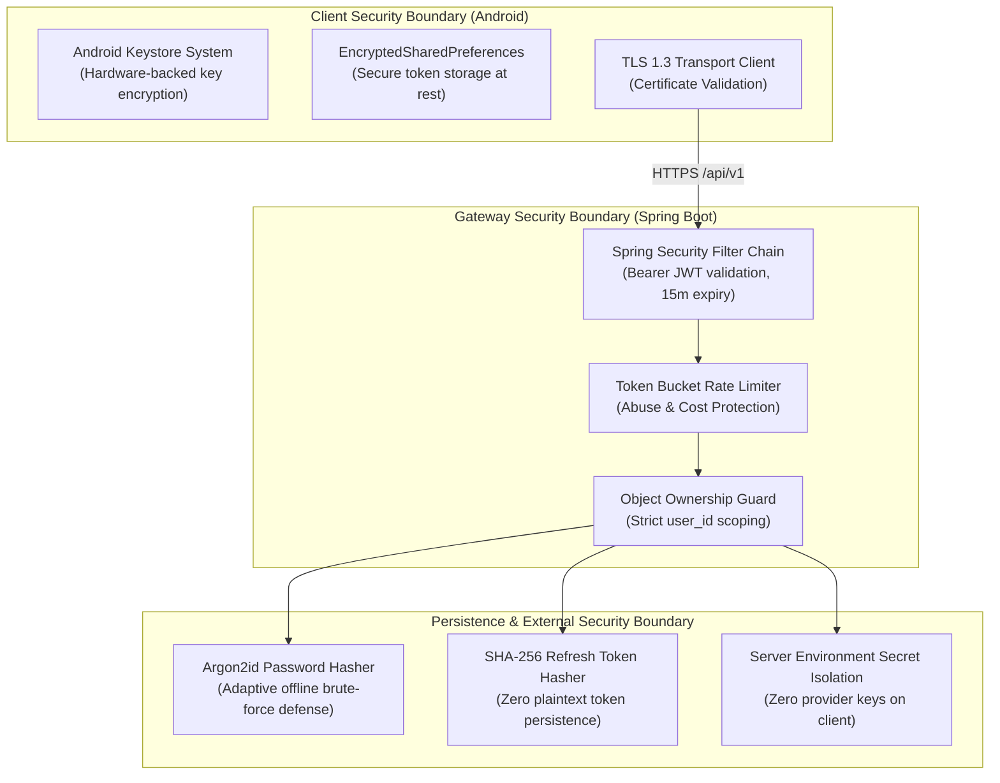
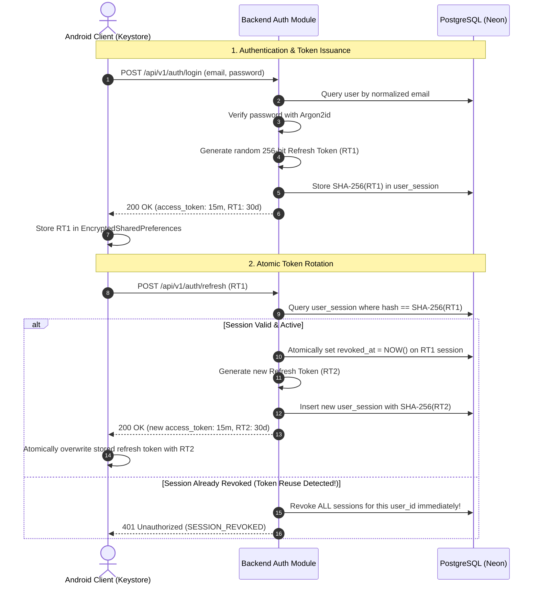
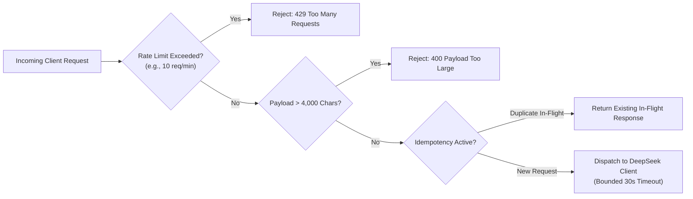

# MIRA — Security Architecture & Data Privacy Specification

| Attribute | Value |
| :--- | :--- |
| **Document ID** | MIRA-SEC-001 |
| **Classification** | Internal Engineering Specification |
| **Status** | Approved Baseline |
| **Version** | 1.0.0 |
| **Last Updated** | 2026-10-11 |
| **Author / Lead** | Bryan / MIRA Security & Privacy Lead |
| **Compliance Baseline** | OWASP Mobile & API Top 10, Data Minimization Standards |

---

## Document Revision History

| Version | Date | Author | Description of Changes |
| :--- | :--- | :--- | :--- |
| 0.1.0 | 2026-10-10 | Security Team | Initial draft threat model and credential handling guidelines. |
| 1.0.0 | 2026-10-11 | Bryan | Enterprise standardization: integrated STRIDE threat matrix, visual Mermaid token sequence, Android Keystore specs, and consolidated all draft updates. |

---

## 1. Security Architecture Principles

MIRA enforces a defense-in-depth model across the mobile client, API gateway, persistence engine, and external AI integration:

1. **Zero Secret Distribution to Mobile Clients:** Third-party LLM credentials (`DEEPSEEK_API_KEY`) and database credentials are stored solely in server environment variables. Android application packages (APKs) contain zero infrastructure secrets.
2. **Server-Side Authorization Everywhere:** The Android client is treated as an untrusted presentation layer. Every data access or mutation is strictly verified against the authenticated principal derived from the cryptographically validated access token.
3. **Data Minimization by Construction:** Memory extraction is strictly bounded to communication-style attributes. Raw passwords, tokens, full chat transcripts, and model prompts are never emitted into server application logs.

---

## 2. Threat Modeling & Risk Mitigation Matrix (STRIDE)

| Threat Category | Specific Threat Scenario | Impact | Required Engineering Mitigation |
| :--- | :--- | :--- | :--- |
| **Spoofing** | Adversary attempts credential stuffing or brute-force logins. | Account Takeover | Enforce adaptive Argon2id password hashing, per-IP and per-account rate limits, and generic login failure messages. |
| **Tampering** | User attempts to modify another user's conversation ID in an API request (IDOR). | Unauthorized Data Mutation | Enforce explicit ownership check (`WHERE id = :convId AND user_id = :userId`) on every query. Return generic `404 Not Found`. |
| **Repudiation** | Client resubmits timed-out requests, claiming assistant generated incorrect output. | Inconsistent State / Double Billing | Require client-supplied `Idempotency-Key` headers; maintain immutable `ai_processing_attempt` audit logs. |
| **Information Disclosure** | DeepSeek API key extracted from decompiled Android APK. | Catastrophic Provider Compromise | Abstract provider calls behind backend gateway; never compile provider keys or database strings into client APKs. |
| **Information Disclosure** | Sensitive conversation turns logged in application error logs. | User Privacy Violation | Enforce structured, sanitized logging; log only request IDs, HTTP status codes, and sanitized exception categories. |
| **Denial of Service** | Automated bot exhausts DeepSeek monthly credit balance via message flooding. | Financial Exhaustion / Service Outage | Enforce per-account rate limits (e.g., max 10 messages/minute), message character limits (max 4,000 chars), and strict provider timeouts. |
| **Elevation of Privilege** | Stale asynchronous memory task restores a deleted user style profile. | Privacy Breach / Broken User Governance | Enforce generation counters and optimistic concurrency control (OCC). Older generations abort automatically upon commit attempt. |

---

## 3. Authentication & Token Session Architecture

MIRA utilizes a high-security dual-token session architecture:

### 3.1 Token Lifecycle Invariants
* **Access Tokens:**
  * Lifetime: Exactly 15 minutes.
  * Signed via HMAC-SHA256 (or RSA/ECDSA) with a server-managed private key (`JWT_SIGNING_KEY`).
  * Statelessly verified by Spring Security filters on every protected endpoint.
* **Refresh Tokens:**
  * Lifetime: 30 days.
  * Generated from `java.security.SecureRandom` (minimum 32 bytes / 256 bits of cryptographic entropy).
  * Backend stores only the SHA-256 hash. The plaintext refresh token is returned once to the client and never logged.
* **Reuse Detection Defense:**
  * If an already-rotated refresh token is submitted again, it indicates potential token interception. The backend immediately revokes **all** active sessions belonging to that account, terminating potential attacker access.

---

## 4. Mobile Client Security Baseline (Android)

1. **Hardware-Backed Cryptography:** Tokens and authentication state on Android must be persisted using `EncryptedSharedPreferences` backed by the **Android Keystore System**. Plaintext `SharedPreferences` or local SQLite without encryption is prohibited.
2. **Network Security Configuration:** Android applications must enforce a strict `network_security_config.xml` requiring TLS 1.3 and prohibiting cleartext traffic (`android:usesCleartextTraffic="false"`).
3. **Log Sanitization:** Android code must strip sensitive tokens and conversational data from debug logs (`Log.d`, `Log.v`). In release builds, `BuildConfig.DEBUG` guards or ProGuard/R8 rules must strip logging calls entirely.
4. **Zero Exported Components:** Application Activities, BroadcastReceivers, and Services must have `android:exported="false"` unless explicitly required for OS entry points.

---

## 5. Third-Party Provider Protection & Cost Controls

Connecting an application to a paid inference API introduces significant financial and abuse risks. MIRA establishes concrete guardrails:

* **Server-Side Quota Enforcement:** Per-account request throttling limits brute-force generation or API depletion.
* **Payload Constraints:** Strict maximum character lengths prevent large context submissions that could inflate billing tokens.
* **Timeout & Circuit Breaking:** HTTP requests to DeepSeek enforce a 5-second connection timeout and 30-second read timeout. Network failures transition the request to `UNKNOWN` or `FAILED` rather than initiating unbounded retry storms.
* **Mock Implementations in Test Suites:** CI/CD builds and automated tests execute strictly against `MockAIProvider`. No automated build or integration test touches the live DeepSeek API, ensuring zero unintentional billing.

---

## 6. Privacy & Data Minimization Governance

1. **Isolation of Personal Memory:**
   * Memory extraction prompts are engineered to extract only *communication-style* variables (explanation depth, tone, examples, formatting).
   * Models are explicitly instructed to ignore and discard biographical details, names, addresses, credit cards, or passwords.
2. **User Sovereignty:**
   * Users can view their complete persistent style profile at any time.
   * Users can toggle memory off, instantly removing it from future LLM context assembly.
   * Users can permanently delete their style memory via `DELETE /api/v1/memory/style`, which increments the generation counter and ensures delayed background jobs cannot recreate the profile.
3. **Log Sanitization:**
   * Log formatters automatically mask Authorization headers, passwords, and prompt message bodies.
   * Internal diagnostics utilize unique request tracking UUIDs (`requestId`) to trace errors across log streams without exposing user data.