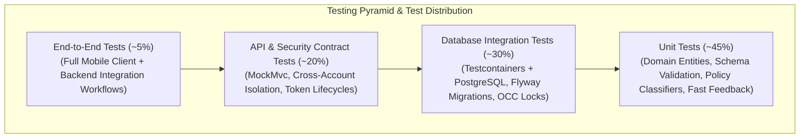
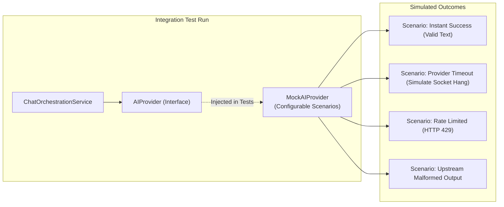
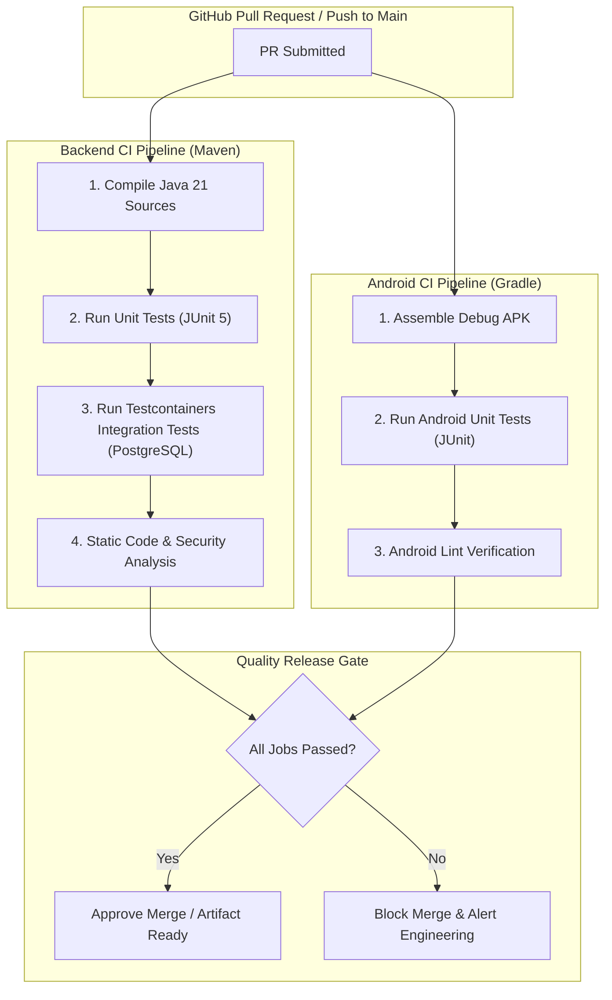

# MIRA — Automated Testing & Quality Assurance Strategy

| Attribute | Value |
| :--- | :--- |
| **Document ID** | MIRA-TST-001 |
| **Classification** | Internal Engineering Specification |
| **Status** | Approved Baseline |
| **Version** | 1.2.0 |
| **Last Updated** | 2026-10-23 |
| **Author / Lead** | Bryan / MIRA Quality Assurance & Test Engineering |
| **Testing Scope** | Multi-Tier Automated Testing, Testcontainers, Mock Doubles |

---

## Document Revision History

| Version | Date | Author | Description of Changes |
| :--- | :--- | :--- | :--- |
| 0.1.0 | 2026-10-10 | QA Team | Initial test pyramid, unit test scope, and mock strategy draft. |
| 1.0.0 | 2026-10-11 | Bryan | Enterprise standardization: integrated visual Mermaid test pyramid, CI pipeline, lifecycle retry test matrix, session revocation tests, and consolidated all draft updates. |
| 1.1.0 | 2026-10-21 | Bryan | Reconciled the test baseline with the implemented suites, Java 21/Testcontainers versions, Flyway V1–V8, and the Phase 1/Phase 2 delivery split. |
| 1.2.0 | 2026-10-23 | Bryan | Reconciled test inventory to 52 passing tests, updated migration baseline to V1–V9, and marked completed Phase 1 lifecycle/retry test scenarios. |

---

## 1. Testing Philosophy & Core Principles

MIRA adheres to four foundational testing principles to ensure rock-solid reliability without incurring cloud provider costs:

1. **Test Observable Behavior, Not Implementation Internals:** Tests verify observable API contracts, HTTP status codes, and database state transitions rather than private class methods or reflection hacks.
2. **Deterministic, Offline-First Test Suites:** Routine automated tests (unit and integration) must **never** make live network requests to the DeepSeek API or depend on production databases. Third-party provider calls are substituted with high-fidelity test doubles (`MockAIProvider`).
3. **Real PostgreSQL via Testcontainers:** Database integration tests run against real PostgreSQL instances spun up via Testcontainers. In-memory databases (like H2) are prohibited because they fail to reproduce PostgreSQL-specific JSONB operations, check constraints, and concurrency locking semantics.
4. **Explicit Concurrency & Security Verification:** Race conditions (memory deletion vs background extraction, duplicate message submissions, token reuse) and authorization boundaries (IDOR attacks) are tested explicitly with automated negative test suites.

---

## 2. Multi-Tier Testing Pyramid

---

## 3. Test Suites & Verification Scope

### 3.1 Backend Unit Testing
* **Framework:** JUnit 5, Mockito, AssertJ.
* **Execution Target:** Sub-second execution; runs on every build.
* **Verification Scope:**
  * Password hashing validation and email normalization rules.
  * Memory schema allow-list validation (valid vs invalid enum keys and values).
  * Hybrid policy classification (explicit durable vs ephemeral task vs weak inference).
  * Bounded context truncation logic (sliding window of chat turns).
  * Provider error mapping (HTTP 429 to rate-limited exception, 504 to gateway timeout).

### 3.2 Database Integration Testing (Testcontainers)
* **Framework:** Spring Boot Test (`@DataJpaTest`), Testcontainers PostgreSQL.
* **Verification Scope:**
  * **Flyway Migrations:** Verify that all versioned migrations (`V1` through `V9`) execute successfully from a clean database. The current suite uses `postgres:18-alpine` through Testcontainers.
  * **Relational Constraints:** Verify that deleting a `user_account` cascades to `conversation` and `message` records, but leaves unrelated data intact.
  * **Optimistic Concurrency Control (OCC):** Verify that concurrent `UPDATE user_style_profile` operations with identical `expectedVersion` integers permit only one update and trigger a version conflict on the second.
  * **Idempotency Uniqueness:** Verify that inserting duplicate `(conversation_id, idempotency_key)` tuples violates database unique constraints.

### 3.3 API Contract & Security Testing
* **Framework:** Spring MockMvc / WebTestClient with Spring Security context.
* **Verification Scope:**
  * **Authentication:** Verify registration, login, token rotation, and invalid credential rejections. Registration, login, refresh, logout, and `/me` are implemented and covered; dedicated rotation/replay tests remain Phase 1.
  * **Session Revocation & Reuse:** Verify that using an already-rotated refresh token revokes the implicated session and rejects further use of that token. Current tests cover logout revocation and post-logout refresh rejection; replay-specific tests are Phase 1.
  * **Object-Level Authorization (IDOR):** Verify that User A attempting to read, modify, or delete User B's conversation receives `404 Not Found`.
  * **Uniform Error Formatting:** Verify that invalid inputs return the standard JSON error schema with appropriate error codes.

### 3.4 AI Provider Testing & Simulation

The `MockAIProvider` enables deterministic simulation of complex edge cases without spending API credits or encountering live network flakiness.

### 3.5 Current Test Inventory (2026-10-23)

| Suite | Type | Tests | Scope |
| :--- | :--- | :--- | :--- |
| `MiraBackendApplicationTests` | Spring Boot + Testcontainers + MockMvc | 41 | Registration, duplicate email, login/logout/refresh, `/me`, conversation CRUD, cursor pagination, message send, lifecycle transitions, idempotency replay, payload conflict, bounded retry, and cross-account isolation. |
| `DeepSeekAIProviderTests` | Unit + MockRestServiceServer | 6 | OpenAI-compatible request serialization, Bearer authorization, response parsing, and HTTP status/error mapping (timeout, 429 rate limit, 5xx unavailable, 4xx provider error, invalid/blank output). |
| `MockAIProviderTests` | Unit | 5 | Deterministic simulation of instant success, timeout, HTTP 429 rate limiting, HTTP 5xx error, and malformed response scenarios. |
| `TokenServiceTests` | Unit | 5 | JWT claims and expiry, refresh-token uniqueness/URL safety, deterministic SHA-256 hashing. |
| `JwtConfigurationTests` | Unit | 1 | Secret validation and decoder configuration. |

The suite (58 tests total) runs against a real PostgreSQL container (`postgres:18-alpine`) with Flyway applying `V1`–`V9`. No test contacts DeepSeek. The classes should be split by domain as the Phase 1 surface grows; the current consolidated class is a baseline, not the target structure.

---

## 4. Lifecycle, Retry & Concurrency Test Matrix

| Test Suite Category | Scenario Description | Input / Setup | Expected Observable Assertion | Phase |
| :--- | :--- | :--- | :--- | :--- |
| **Response Lifecycle** | Successful Response | User submits valid prompt. | Logical response transitions to `COMPLETED`; assistant message persisted; eligible for memory extraction. | Implemented (Backend) |
| **Response Lifecycle** | Provider Timeout | `MockAIProvider` throws `TimeoutException`. | Logical response transitions to `UNKNOWN`; user message remains intact; attempt logged as `TIMEOUT`. | Implemented (Backend) |
| **Response Lifecycle** | Provider Terminal Failure | `MockAIProvider` returns HTTP 500 error. | Logical response transitions to `FAILED`; attempt logged as `ERROR`. | Implemented (Backend) |
| **Idempotent Retry** | Client Submits Identical Key | Re-send request with same `Idempotency-Key` and payload. | Returns existing response without dispatching duplicate AI request or duplicating messages. | Implemented (Backend) |
| **Idempotent Retry** | Client Reuses Key with New Body | Re-send same `Idempotency-Key` with different message. | Server rejects request with `409 Conflict` and error code `idempotency_conflict`. | Implemented (Backend) |
| **Memory Gating** | Extraction from Incomplete Response | Response is `PENDING`, `FAILED`, or `UNKNOWN`. | Extraction service strictly skips task; zero memory updates committed. | Phase 2 |
| **Memory Concurrency** | OCC Version Collision | Two threads attempt update with `expectedVersion: 4`. | Thread 1 succeeds (version becomes 5); Thread 2 receives `409 Conflict` (`version_conflict`). | Phase 2 |
| **Memory Deletion Race**| Background Extraction vs User Purge | Extraction task starts; User executes `DELETE /memory/style`; Extraction finishes. | Extraction task detects incremented `generation` counter and aborts; profile remains completely purged. | Phase 2 |
| **Session Security** | Refresh Token Rotation | Client calls `POST /auth/refresh` with valid RT1. | RT1 is marked consumed; RT2 is issued and verified active; the session ID is unchanged. | Implemented (Backend) |
| **Session Security** | Token Reuse Interception | Client attempts to reuse consumed RT1. | Server detects reuse, revokes the implicated session, and returns `401 Unauthorized`. Global all-session revocation is a hardening item. | Implemented (Backend) |

---

## 5. Continuous Integration (CI) Workflow

> [!NOTE]
> GitHub Actions workflows are **not yet configured** in this repository. The pipeline above is the Phase 1 target; until it exists, run `.\mvnw.cmd clean verify` locally before merging backend changes.

---

## 6. Definition of Done & Release Gating Checklist

Before any feature or sprint release is accepted into the production branch, all of the following conditions must be satisfied:

- [ ] 100% of backend unit and Testcontainers integration tests pass locally and in CI.
- [ ] Cross-account authorization (IDOR) tests verify that resources cannot be accessed across user boundaries.
- [ ] Memory concurrency tests prove that stale background tasks cannot overwrite manual user edits or resurrect deleted memory.
- [ ] Refresh token rotation and token reuse detection are verified with automated test cases.
- [ ] All database migrations (`V1`..`Vn`) execute cleanly against an empty PostgreSQL instance.
- [ ] No API keys, passwords, or raw user message transcripts are emitted into application log files.
- [ ] Android application builds cleanly in debug and release modes with zero lint errors.
- [ ] Core conversational flow is manually verified on at least one physical Android device.
