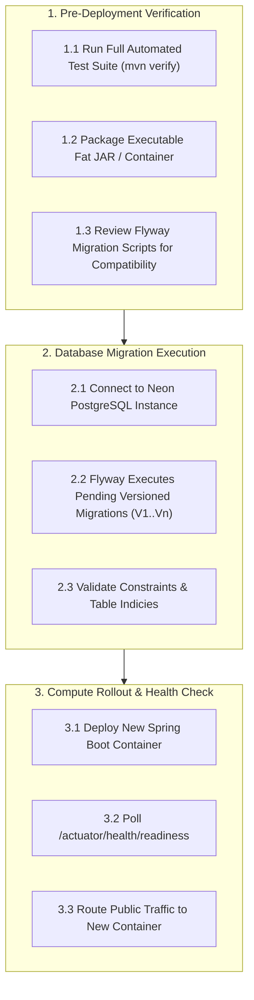
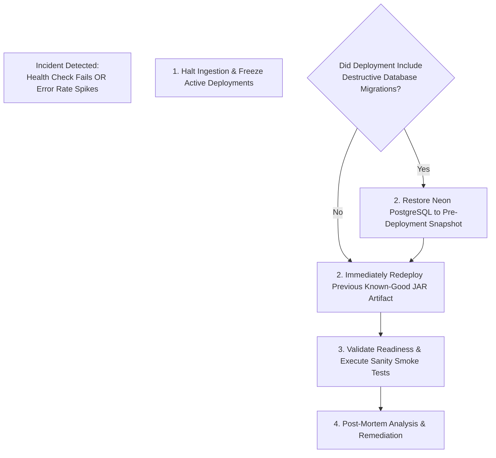

# MIRA — Production Deployment & Operational Runbook

| Attribute | Value |
| :--- | :--- |
| **Document ID** | MIRA-OPS-001 |
| **Classification** | Internal Engineering Specification |
| **Status** | Approved Baseline |
| **Version** | 2.2.0 |
| **Last Updated** | 2026-11-13 |
| **Author / Lead** | Bryan / MIRA DevOps & Infrastructure Team |
| **Hosting Platform** | Render (Docker Web Service) + Neon PostgreSQL |

---

## Document Revision History

| Version | Date | Author | Description of Changes |
| :--- | :--- | :--- | :--- |
| 0.1.0 | 2026-10-10 | Operations Team | Initial deployment topology and environment variable draft. |
| 1.0.0 | 2026-10-11 | Bryan | Enterprise standardization: integrated visual Mermaid deployment topology, rollback runbook, health check actuary specs, and secret management standards. |
| 1.1.0 | 2026-10-21 | Bryan | Reconciled runtime versions, environment-variable names, migration range, and actuator behavior with the implemented backend. |
| 1.2.0 | 2026-10-23 | Bryan | Updated pre-production verification checklist to include Flyway migrations V1 through V9. |
| 1.3.0 | 2026-10-25 | Bryan | Reconciled implemented Actuator health probes (`liveness` & `readiness` enabled and restricted to health) and documented Docker Compose local environment. |
| 1.4.0 | 2026-10-26 | Bryan | Recorded Phase 1 closure and Phase 2 backend progress; deployment remains a Phase 3 activity. |
| 1.5.0 | 2026-10-27 | Bryan | Recorded backend advisory prompt injection; deployment remains a Phase 3 activity. |
| 1.6.0 | 2026-10-27 | Bryan | Documented extraction scheduler configuration and the in-process polling model; deployment remains a Phase 3 activity. |
| 1.7.0 | 2026-10-27 | Bryan | Recorded backend candidate-review endpoints; deployment remains a Phase 3 activity. |
| 1.8.0 | 2026-10-29 | Bryan | Documented extraction retry/recovery settings and skip-locked claiming. Deployment remains a Phase 3 activity. |
| 1.9.0 | 2026-11-13 | Bryan | Reconciled Android memory management client delivery; deployment remains a Phase 3 activity. |
| 2.0.0 | 2026-11-13 | Bryan | Recorded Phase 3 security hardening: authentication rate-limit configuration and account-wide replay revocation. Deployment remains a Phase 3 activity. |
| 2.1.0 | 2026-11-14 | Bryan | Documented Android release signing, configurable version/API values, and the tag-based release workflow. |
| 2.2.0 | 2026-11-14 | Bryan | Documented the production Docker image, `prod` profile, Render + Neon deployment flow, and local container verification. |

---

## 1. Cloud Infrastructure Topology

MIRA maintains a streamlined, single-monolith operational architecture designed for high maintainability, predictable costs, and robust security isolation:

```mermaid
flowchart TD
    subgraph MobileClients ["Client Perimeter"]
        AndroidDevice["Physical Android Device\n(APK Release Build)\n- Hardened TLS 1.3\n- Android Keystore Encrypted"]
    end

    subgraph InternetEdge ["Network Boundary (Cloud PaaS)"]
        EdgeRouter["Reverse Proxy & TLS Termination\n(HTTPS Port 443)\n- Auto SSL Certificate Renewal\n- DDoS Protection"]
    end

    subgraph ComputePerimeter ["Compute Perimeter (Docker / JAR Container)"]
        SpringApp["Spring Boot 4.1.x Modular Monolith\n(Java 21 Runtime)\n- Port ${SERVER_PORT:8080}\n- Actuator Health Endpoints\n- Secret-Isolated Environment"]
    end

    subgraph DataPerimeter ["Managed Data Perimeter"]
        NeonDB[("Neon Managed PostgreSQL\n- Encrypted at Rest & in Transit (SSL)\n- Automated Branching & Snapshots\n- Connection Pool (HikariCP)")]
        DeepSeekEdge["DeepSeek API Endpoint\n(Stateless LLM Inference)\n- Authenticated via DEEPSEEK_API_KEY"]
    end

    AndroidDevice -->|HTTPS /api/v1| EdgeRouter
    EdgeRouter -->|HTTP Internal Proxy| SpringApp
    SpringApp -->|PostgreSQL TLS (Port 5432)| NeonDB
    SpringApp -->|HTTPS POST Outbound| DeepSeekEdge
```

---

## 2. Environment Strategy & Secret Management

Configuration is strictly divided between non-secret environment properties and sensitive infrastructure secrets:

### 2.1 Configuration Matrix

| Variable Name | Classification | Environment | Purpose / Value Description |
| :--- | :--- | :--- | :--- |
| `SERVER_PORT` | Non-Secret | All | HTTP listening port (defaults to `8080`). |
| `SPRING_PROFILES_ACTIVE` | Non-Secret | All | Active profile (`dev`, `test`, `prod`). |
| `SPRING_DATASOURCE_URL` | Secret | Prod / Dev | JDBC connection string (e.g., `jdbc:postgresql://ep-...neon.tech/mira?sslmode=require`). |
| `SPRING_DATASOURCE_USERNAME` | Secret | Prod / Dev | Managed database user account. |
| `SPRING_DATASOURCE_PASSWORD` | Secret | Prod / Dev | Secure database password. |
| `DEEPSEEK_API_KEY` | Secret | Phase 1+ | Server-side bearer token for DeepSeek API. Not needed until provider integration lands. |
| `MIRA_JWT_SECRET_BASE64` | Secret | All | Base64-encoded HMAC-SHA256 signing key; must decode to at least 32 bytes. Application startup fails if missing or invalid. |
| `mira.memory.extraction.scheduler-enabled` | Non-Secret | All | Enables the in-process extraction poller (default `true`; `false` in the test profile). |
| `mira.memory.extraction.poll-interval-ms` | Non-Secret | All | Fixed delay between extraction polls in milliseconds (default `2000`). |
| `mira.memory.extraction.max-attempts` | Non-Secret | All | Maximum claim/processing attempts per job before it becomes `FAILED` (default `3`). |
| `mira.memory.extraction.stale-after-seconds` | Non-Secret | All | Age after which a `PROCESSING` job is considered abandoned and requeued (default `300`). |
| `mira.memory.extraction.recovery-interval-ms` | Non-Secret | All | Fixed delay between stale-job recovery sweeps (default `60000`). |
| `mira.auth.rate-limit.login-email-limit` | Non-Secret | All | Login attempts per normalized email per window (default `5`; `0` disables). |
| `mira.auth.rate-limit.login-ip-limit` | Non-Secret | All | Login attempts per client IP per window (default `30`; `0` disables). |
| `mira.auth.rate-limit.register-ip-limit` | Non-Secret | All | Registration attempts per client IP per window (default `5`; `0` disables). |
| `mira.auth.rate-limit.refresh-ip-limit` | Non-Secret | All | Refresh attempts per client IP per window (default `60`; `0` disables). |
| `mira.auth.rate-limit.window-seconds` | Non-Secret | All | Sliding-window length for auth throttling (default `60`). |
| `mira.auth.rate-limit.trust-forwarded-headers` | Non-Secret | Prod | Trust `X-Forwarded-For` for client IP resolution. Enable only behind a trusted reverse proxy. |
| `mira.auth.rate-limit.cleanup-interval-ms` | Non-Secret | All | Expired-window cleanup interval (default `600000`). |

> [!CAUTION]
> **Zero Secret Check-in Rule:**
> Secrets must **never** be committed to Git, hardcoded in `application.properties`, or compiled into Android APKs. In local development, use an untracked `.env` file or process environment variables; in production, inject values via the hosting platform's secure secret manager.

> [!IMPORTANT]
> `backend/src/main/resources/application.properties` does not contain a default datasource. `SPRING_DATASOURCE_URL`, `SPRING_DATASOURCE_USERNAME`, and `SPRING_DATASOURCE_PASSWORD` must be supplied in every environment, including local development. Integration tests provide them dynamically through Testcontainers.

### 2.2 Android Release Signing

Release builds are signed only when all signing values are supplied. The build reads either environment variables or an untracked `android/keystore.properties`.

| Variable | Required | Purpose |
| :--- | :--- | :--- |
| `MIRA_KEYSTORE_FILE` | Yes (release) | Absolute path to the release keystore, or a path relative to `android/`. |
| `MIRA_KEYSTORE_PASSWORD` | Yes (release) | Keystore password. |
| `MIRA_KEY_ALIAS` | Yes (release) | Release key alias. |
| `MIRA_KEY_PASSWORD` | Yes (release) | Key password. |
| `MIRA_API_BASE_URL` | Yes (release) | Public backend base URL baked into `BuildConfig.API_BASE_URL`. |
| `MIRA_VERSION_CODE` | No | Integer version code; defaults to `1` locally and the workflow run number in CI. |
| `MIRA_VERSION_NAME` | No | Version name; defaults to `1.0` locally and the `v*` tag in CI. |

The `Android Release` workflow (`.github/workflows/android-release.yml`) runs on `v*` tags or manual dispatch. It decodes `MIRA_KEYSTORE_BASE64` into `$RUNNER_TEMP`, builds a signed APK and AAB, verifies the APK with `apksigner`, and uploads both artifacts. Configure the four signing secrets and either a `MIRA_API_BASE_URL` repository variable or the manual-dispatch input before tagging a release.

---

## 3. Database Migration & Deployment Order

To avoid downtime or schema locking issues, database migrations must execute prior to or in lockstep with application container boot.



### 3.1 Expand-and-Contract Migration Pattern
When making schema modifications (e.g., renaming columns or adding constraints):
1. **Expand:** Add new columns as nullable in migration `V_n`. Deploy application code capable of reading both old and new columns.
2. **Backfill:** Populate the new columns via background update scripts.
3. **Contract:** In subsequent release migration `V_n+1`, apply `NOT NULL` constraints and drop deprecated columns.

### 3.2 Container Image

The backend ships as a multi-stage Docker image defined in `backend/Dockerfile`:

- Build stage: `eclipse-temurin:21-jdk-jammy`, Maven wrapper, tests skipped (CI already runs them).
- Runtime stage: `eclipse-temurin:21-jre-alpine`, non-root `mira` user, JRE 21.
- Default profile: `prod`.
- Binds to `${PORT}` (Render) with `SERVER_PORT` fallback.
- Container healthcheck: `GET /actuator/health`.

Build and run locally:

```powershell
docker build -t mira-backend:ci backend

docker run --rm -p 8080:8080 `
  -e SPRING_PROFILES_ACTIVE=prod `
  -e MIRA_JWT_SECRET_BASE64="<base64-secret>" `
  -e SPRING_DATASOURCE_URL="jdbc:postgresql://host.docker.internal:5432/mira" `
  -e SPRING_DATASOURCE_USERNAME="mira" `
  -e SPRING_DATASOURCE_PASSWORD="admin123" `
  -e DEEPSEEK_API_KEY="<key>" `
  mira-backend:ci
```

The `prod` profile enables ECS-formatted JSON logs, graceful shutdown, forward-header handling, Hikari pool settings, and Flyway validation. The backend workflow builds the image on every push so Dockerfile regressions fail CI.

### 3.3 Render Deployment

1. Create a Neon PostgreSQL project and copy the **pooled** JDBC URL, including `?sslmode=require`.
2. Push the repository to GitHub.
3. In Render, choose **New → Blueprint**, select the repository, and apply `render.yaml`.
4. Set the following secrets on the service:
   - `MIRA_JWT_SECRET_BASE64`
   - `SPRING_DATASOURCE_URL`
   - `SPRING_DATASOURCE_USERNAME`
   - `SPRING_DATASOURCE_PASSWORD`
   - `DEEPSEEK_API_KEY`
5. Confirm `SPRING_PROFILES_ACTIVE=prod`, `MIRA_TRUST_FORWARDED_HEADERS=true`, and `JAVA_OPTS` from the blueprint.
6. Deploy. Render builds `backend/Dockerfile`, injects `PORT`, and polls `/actuator/health/readiness`.
7. Verify:

```powershell
curl https://<service>.onrender.com/actuator/health
curl https://<service>.onrender.com/actuator/health/readiness
```

8. Register a smoke account and send a message through the Android client or API.
9. Set the Android release `MIRA_API_BASE_URL` to the Render HTTPS URL.

> [!WARNING]
> Neon's direct (non-pooled) connection string can exhaust PostgreSQL connection limits under load. Use the pooled URL and keep the Hikari maximum at or below the plan limit.

---

## 4. Application Health & Observability

MIRA leverages **Spring Boot Actuator** to provide secure, non-leaking health telemetry for load balancers and orchestrators.

### 4.1 Health Check Endpoints
* **Current Endpoint:** `GET /actuator/health`
  * Exposed and permitted without authentication (`management.endpoints.web.exposure.include=health`).
* **Liveness Probe:** `GET /actuator/health/liveness` — **Implemented.**
  * Checks that the JVM process is responsive and returns `200 OK` (`{"status":"UP"}`).
* **Readiness Probe:** `GET /actuator/health/readiness` — **Implemented.**
  * Verifies database connectivity via the datasource before routing incoming traffic (`{"status":"UP"}`).
* **Security Guard:** Full Actuator details, environment configurations, and heap dumps are strictly disabled on the public web interface to prevent sensitive credential disclosure. The health endpoint is the only exposed actuator endpoint.

### 4.2 Logging Standards
* Structured JSON logging via SLF4J / Logback.
* User prompts, full AI completions, passwords, and Authorization headers are automatically scrubbed.
* Every HTTP request receives a unique UUID tracking header (`X-Request-Id`) that propagates through all backend log statements for seamless incident correlation.

---

## 5. Rollback & Incident Response Procedures

If a critical fault or data integrity regression is detected post-deployment, follow the automated incident response flow:



### 5.1 Secret Rotation Protocol
If a sensitive secret (e.g., `DEEPSEEK_API_KEY` or `MIRA_JWT_SECRET_BASE64`) is accidentally exposed:
1. Immediately generate a replacement key in the respective provider portal.
2. Update the secret in the cloud platform environment settings.
3. Trigger a graceful restart of the backend service.
4. Revoke the compromised key in the provider portal.
5. Invalidate all active user sessions to force re-authentication if `MIRA_JWT_SECRET_BASE64` was compromised.

---

## 6. Pre-Production Release Verification Checklist

> [!NOTE]
> MIRA is not yet deployed. Phase 1 (chat core) and Phase 2 (communication-style memory) are complete. Phase 3 is in progress: authentication rate limiting and account-wide replay revocation are implemented; release signing, backend deployment, and observability remain. Production deployment is a Phase 3 activity.

> [!WARNING]
> Extraction uses in-process `@Scheduled` pollers that claim `PENDING` jobs with `FOR UPDATE SKIP LOCKED` and requeue stale `PROCESSING` jobs. Claims are safe across multiple application instances and commit is guarded by generation/version checks, so leader election is not required. Keep `stale-after-seconds` comfortably above the provider timeout to avoid requeueing healthy work.

Before opening the deployed service to physical Android client connections, verify the following:

- [ ] Backend builds reproducibly using `./mvnw clean verify`.
- [ ] Neon PostgreSQL SSL connections enforce certificate verification (`sslmode=require`).
- [ ] Flyway successfully applies all versioned migrations (`V1` through `V10`).
- [ ] Public endpoint enforces TLS 1.3; plain HTTP traffic is redirected or rejected.
- [ ] Actuator health check returns `{"status":"UP"}` on `/actuator/health`.
- [ ] Rate limiting actively blocks rapid unauthenticated requests.
- [ ] Repeated failed logins return `429 rate_limited` after the configured threshold.
- [ ] End-to-end smoke test creates an account, starts a conversation, and receives an AI response.
- [ ] Cloud application logs confirm that raw user prompts, passwords, and tokens are completely absent.
- [ ] Android release APK connects successfully to the public HTTPS domain.
- [ ] A `v*` tag produces a signed APK and AAB through the Android Release workflow.
- [ ] The signed APK installs on a physical device and completes the smoke flow.
