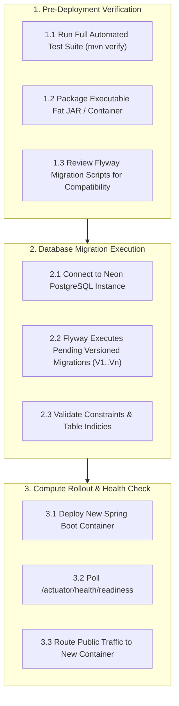
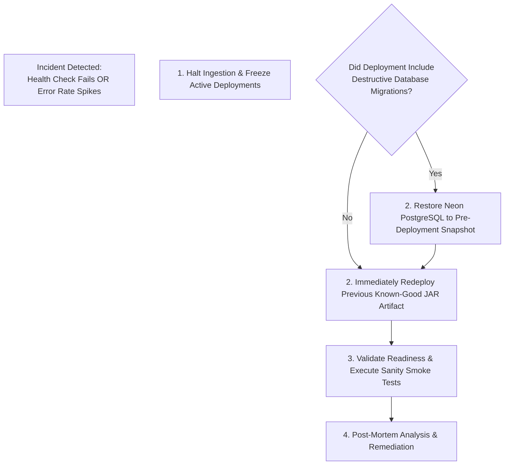

# MIRA — Production Deployment & Operational Runbook

| Attribute | Value |
| :--- | :--- |
| **Document ID** | MIRA-OPS-001 |
| **Classification** | Internal Engineering Specification |
| **Status** | Approved Baseline |
| **Version** | 1.4.0 |
| **Last Updated** | 2026-10-26 |
| **Author / Lead** | Bryan / MIRA DevOps & Infrastructure Team |
| **Hosting Platform** | Cloud PaaS (e.g., Render / Fly.io / AWS ECS) + Neon PostgreSQL |

---

## Document Revision History

| Version | Date | Author | Description of Changes |
| :--- | :--- | :--- | :--- |
| 0.1.0 | 2026-10-10 | Operations Team | Initial deployment topology and environment variable draft. |
| 1.0.0 | 2026-10-11 | Bryan | Enterprise standardization: integrated visual Mermaid deployment topology, rollback runbook, health check actuary specs, and secret management standards. |
| 1.1.0 | 2026-10-21 | Bryan | Reconciled runtime versions, environment-variable names, migration range, and actuator behavior with the implemented backend. |
| 1.2.0 | 2026-10-23 | Bryan | Updated pre-production verification checklist to include Flyway migrations V1 through V9. |
| 1.3.0 | 2026-10-25 | Bryan | Reconciled implemented Actuator health probes (`liveness` & `readiness` enabled and restricted to health) and documented Docker Compose local environment. |
| 1.4.0 | 2026-10-26 | Bryan | Recorded Phase 1 closure and Phase 2 backend progress; deployment remains a Phase 3 activity. |

---

## 1. Cloud Infrastructure Topology

MIRA maintains a streamlined, single-monolith operational architecture designed for high maintainability, predictable costs, and robust security isolation:

```mermaid
flowchart TD
    subgraph MobileClients ["Client Perimeter"]
        AndroidDevice["Physical Android Device\n(APK Release Build)\n- Hardened TLS 1.3\n- Android Keystore Encrypted"]
    end

    subgraph InternetEdge ["Network Boundary (Cloud PaaS)"]
        EdgeRouter["Reverse Proxy & TLS Termination\n(HTTPS Port 443)\n- Auto SSL Certificate Renewal\n- DDoS Protection"]
    end

    subgraph ComputePerimeter ["Compute Perimeter (Docker / JAR Container)"]
        SpringApp["Spring Boot 4.1.x Modular Monolith\n(Java 21 Runtime)\n- Port ${SERVER_PORT:8080}\n- Actuator Health Endpoints\n- Secret-Isolated Environment"]
    end

    subgraph DataPerimeter ["Managed Data Perimeter"]
        NeonDB[("Neon Managed PostgreSQL\n- Encrypted at Rest & in Transit (SSL)\n- Automated Branching & Snapshots\n- Connection Pool (HikariCP)")]
        DeepSeekEdge["DeepSeek API Endpoint\n(Stateless LLM Inference)\n- Authenticated via DEEPSEEK_API_KEY"]
    end

    AndroidDevice -->|HTTPS /api/v1| EdgeRouter
    EdgeRouter -->|HTTP Internal Proxy| SpringApp
    SpringApp -->|PostgreSQL TLS (Port 5432)| NeonDB
    SpringApp -->|HTTPS POST Outbound| DeepSeekEdge
```

---

## 2. Environment Strategy & Secret Management

Configuration is strictly divided between non-secret environment properties and sensitive infrastructure secrets:

### 2.1 Configuration Matrix

| Variable Name | Classification | Environment | Purpose / Value Description |
| :--- | :--- | :--- | :--- |
| `SERVER_PORT` | Non-Secret | All | HTTP listening port (defaults to `8080`). |
| `SPRING_PROFILES_ACTIVE` | Non-Secret | All | Active profile (`dev`, `test`, `prod`). |
| `SPRING_DATASOURCE_URL` | Secret | Prod / Dev | JDBC connection string (e.g., `jdbc:postgresql://ep-...neon.tech/mira?sslmode=require`). |
| `SPRING_DATASOURCE_USERNAME` | Secret | Prod / Dev | Managed database user account. |
| `SPRING_DATASOURCE_PASSWORD` | Secret | Prod / Dev | Secure database password. |
| `DEEPSEEK_API_KEY` | Secret | Phase 1+ | Server-side bearer token for DeepSeek API. Not needed until provider integration lands. |
| `MIRA_JWT_SECRET_BASE64` | Secret | All | Base64-encoded HMAC-SHA256 signing key; must decode to at least 32 bytes. Application startup fails if missing or invalid. |

> [!CAUTION]
> **Zero Secret Check-in Rule:**
> Secrets must **never** be committed to Git, hardcoded in `application.properties`, or compiled into Android APKs. In local development, use an untracked `.env` file or process environment variables; in production, inject values via the hosting platform's secure secret manager.

> [!IMPORTANT]
> `backend/src/main/resources/application.properties` does not contain a default datasource. `SPRING_DATASOURCE_URL`, `SPRING_DATASOURCE_USERNAME`, and `SPRING_DATASOURCE_PASSWORD` must be supplied in every environment, including local development. Integration tests provide them dynamically through Testcontainers.

---

## 3. Database Migration & Deployment Order

To avoid downtime or schema locking issues, database migrations must execute prior to or in lockstep with application container boot.



### 3.1 Expand-and-Contract Migration Pattern
When making schema modifications (e.g., renaming columns or adding constraints):
1. **Expand:** Add new columns as nullable in migration `V_n`. Deploy application code capable of reading both old and new columns.
2. **Backfill:** Populate the new columns via background update scripts.
3. **Contract:** In subsequent release migration `V_n+1`, apply `NOT NULL` constraints and drop deprecated columns.

---

## 4. Application Health & Observability

MIRA leverages **Spring Boot Actuator** to provide secure, non-leaking health telemetry for load balancers and orchestrators.

### 4.1 Health Check Endpoints
* **Current Endpoint:** `GET /actuator/health`
  * Exposed and permitted without authentication (`management.endpoints.web.exposure.include=health`).
* **Liveness Probe:** `GET /actuator/health/liveness` — **Implemented.**
  * Checks that the JVM process is responsive and returns `200 OK` (`{"status":"UP"}`).
* **Readiness Probe:** `GET /actuator/health/readiness` — **Implemented.**
  * Verifies database connectivity via the datasource before routing incoming traffic (`{"status":"UP"}`).
* **Security Guard:** Full Actuator details, environment configurations, and heap dumps are strictly disabled on the public web interface to prevent sensitive credential disclosure. The health endpoint is the only exposed actuator endpoint.

### 4.2 Logging Standards
* Structured JSON logging via SLF4J / Logback.
* User prompts, full AI completions, passwords, and Authorization headers are automatically scrubbed.
* Every HTTP request receives a unique UUID tracking header (`X-Request-Id`) that propagates through all backend log statements for seamless incident correlation.

---

## 5. Rollback & Incident Response Procedures

If a critical fault or data integrity regression is detected post-deployment, follow the automated incident response flow:



### 5.1 Secret Rotation Protocol
If a sensitive secret (e.g., `DEEPSEEK_API_KEY` or `MIRA_JWT_SECRET_BASE64`) is accidentally exposed:
1. Immediately generate a replacement key in the respective provider portal.
2. Update the secret in the cloud platform environment settings.
3. Trigger a graceful restart of the backend service.
4. Revoke the compromised key in the provider portal.
5. Invalidate all active user sessions to force re-authentication if `MIRA_JWT_SECRET_BASE64` was compromised.

---

## 6. Pre-Production Release Verification Checklist

> [!NOTE]
> MIRA is not yet deployed. Phase 1 (chat core) is complete and merged to `main`, and Phase 2 backend memory governance is in progress. Production deployment is a Phase 3 activity, performed after the Phase 2 memory subsystem is complete and verified.

Before opening the deployed service to physical Android client connections, verify the following:

- [ ] Backend builds reproducibly using `./mvnw clean verify`.
- [ ] Neon PostgreSQL SSL connections enforce certificate verification (`sslmode=require`).
- [ ] Flyway successfully applies all versioned migrations (`V1` through `V9`).
- [ ] Public endpoint enforces TLS 1.3; plain HTTP traffic is redirected or rejected.
- [ ] Actuator health check returns `{"status":"UP"}` on `/actuator/health`.
- [ ] Rate limiting actively blocks rapid unauthenticated requests.
- [ ] End-to-end smoke test creates an account, starts a conversation, and receives an AI response.
- [ ] Cloud application logs confirm that raw user prompts, passwords, and tokens are completely absent.
- [ ] Android release APK connects successfully to the public HTTPS domain.
