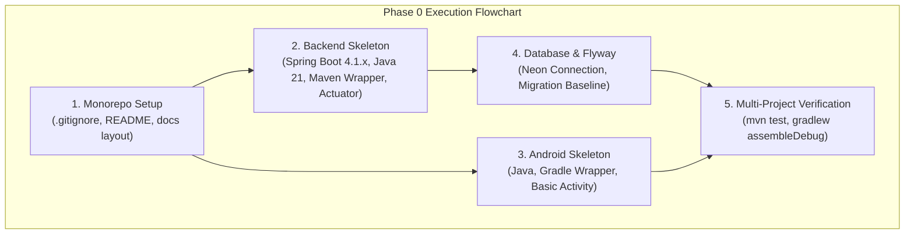

# MIRA — Phase 0: Foundation & Environment Setup Checklist

| Attribute | Value |
| :--- | :--- |
| **Document ID** | MIRA-CHK-000 |
| **Classification** | Internal Engineering Specification |
| **Status** | Active Execution Baseline |
| **Version** | 1.3.0 |
| **Last Updated** | 2026-10-27 |
| **Author / Lead** | Bryan / MIRA Core Engineering Team |
| **Phase Milestone** | Phase 0 — Reproducible Project Foundation (complete; Android APK verification carried into Phase 1) |

---

## Document Revision History

| Version | Date | Author | Description of Changes |
| :--- | :--- | :--- | :--- |
| 0.1.0 | 2026-10-10 | Engineering Team | Initial draft of local development prerequisites and repository setup. |
| 1.0.0 | 2026-10-11 | Bryan | Enterprise standardization: integrated visual Mermaid execution roadmap, concrete skeleton milestones, Flyway setup, and exit gating criteria. |
| 1.1.0 | 2026-10-21 | Bryan | Marked Phase 0 complete, reconciled the actual stack (Java 21, Spring Boot 4.1.x), package layout, dependency list, migration range, and verified exit criteria. |
| 1.2.0 | 2026-10-26 | Bryan | Corrected the migration baseline references from V1–V8 to V1–V9 and noted Phase 1 closure. |
| 1.3.0 | 2026-10-27 | Bryan | Updated the baseline to V1–V10 after the Phase 2 extraction migration. |

---

## 1. Phase 0 Purpose & Objectives

Phase 0 establishes a reproducible development environment, structured monorepo, clean build toolchains, and initial application skeletons **prior** to developing functional MVP features (authentication, chat orchestration, and memory extraction).

### 1.1 Core Objectives
* Verify development toolchains (JDK 21, Maven Wrapper, Android Studio, Gradle, PostgreSQL).
* Establish the official repository structure with strict `.gitignore` rules.
* Scaffold a minimal, compiling Spring Boot 4.1.x backend application with Actuator health checks.
* Scaffold a native Android Java application with Gradle wrapper.
* Establish version-controlled database migrations via Flyway.
* Provide comprehensive local run instructions so any engineer can clone, compile, and test the project in minutes without guesswork.



---

## 2. Target Repository Structure

```text
mira/
├── .gitignore                      # Monorepo root ignore rules (builds, secrets, IDE state)
├── README.md                       # Comprehensive onboarding & developer setup guide
├── LICENSE                         # Project license
│
├── android/                        # Native Android Application (Java / Gradle)
│   ├── app/
│   │   ├── src/
│   │   │   ├── main/
│   │   │   │   ├── java/com/mira/app/
│   │   │   │   └── res/
│   │   │   ├── test/
│   │   │   └── androidTest/
│   │   └── build.gradle.kts
│   ├── gradle/
│   ├── build.gradle.kts
│   ├── settings.gradle.kts
│   ├── gradlew
│   └── gradlew.bat
│
├── backend/                        # Spring Boot Modular Monolith (Java 21 / Maven)
│   ├── src/
│   │   ├── main/
│   │   │   ├── java/com/mira/mira_backend/
│   │   │   │   ├── MiraBackendApplication.java
│   │   │   │   ├── config/
│   │   │   │   ├── controller/
│   │   │   │   ├── dto/
│   │   │   │   ├── entity/
│   │   │   │   ├── exception/
│   │   │   │   ├── repository/
│   │   │   │   ├── security/
│   │   │   │   └── service/
│   │   │   └── resources/
│   │   │       ├── application.properties
│   │   │       └── db/migration/   # Flyway SQL migrations (V1–V10)
│   │   └── test/
│   ├── pom.xml
│   ├── mvnw
│   └── mvnw.cmd
│
└── docs/                           # Central Engineering Documentation
    ├── 00-overview.md
    ├── 01-requirements.md
    ├── 02-architecture.md
    ├── 03-domain-model.md
    ├── 04-api-contract.md
    ├── 05-memory-lifecycle.md
    ├── 06-security-and-privacy.md
    ├── 07-testing-strategy.md
    ├── 08-deployment-plan.md
    ├── 09-phase-0-checklist.md
    ├── 10-phase-1-checklist.md
    └── decisions/                  # Architecture Decision Records (ADRs)
        ├── ADR-001-backend-stack.md
        ├── ADR-002-memory-model.md
        └── ADR-003-file-processing.md
```

---

## 3. Toolchain & Environment Verification

Before executing build commands, ensure the following local prerequisites are confirmed:

- [ ] **Git:** Installed and configured (`git --version`).
- [ ] **Java Development Kit (JDK):** JDK 21 configured (`java -version`).
- [ ] **Android Studio & SDK:** Android SDK platform tools and build tools installed.
- [ ] **PostgreSQL:** Local PostgreSQL or access to Neon cloud development database.
- [ ] **Docker:** Docker Desktop or another Docker runtime for Testcontainers integration tests.
- [ ] **Network Connectivity:** Unrestricted access to Maven Central and Google Maven repositories.

---

## 4. Phase 0 Step-by-Step Execution Plan

### Step 1: Repository Hygiene & Global Ignore Rules
* Create comprehensive `.gitignore` in the repository root ignoring:
  * Maven targets (`backend/target/`).
  * Gradle builds and caches (`android/.gradle/`, `android/app/build/`).
  * IDE directories (`.idea/`, `*.iml`, `.vscode/`).
  * Local secrets and environment files (`.env`, `*.key`, `keystore.jks`).
* Ensure documentation links and paths are standardized.

### Step 2: Initialize Spring Boot Backend Skeleton
* Configure `backend/pom.xml` with the delivered dependency set:
  * `spring-boot-starter-webmvc`
  * `spring-boot-starter-validation`
  * `spring-boot-starter-actuator`
  * `spring-boot-starter-data-jpa`
  * `postgresql` JDBC driver
  * `spring-boot-starter-flyway` + `flyway-database-postgresql`
  * `spring-boot-starter-security` + `spring-boot-starter-oauth2-resource-server` + `spring-security-oauth2-jose`
  * `spring-security-crypto` + `bcprov-jdk18on` (Argon2id)
  * `testcontainers-postgresql` + `testcontainers-junit-jupiter`
  * `spring-boot-starter-test` equivalents (`*-test` starters)
* Scaffold entry point: `com.mira.mira_backend.MiraBackendApplication`.
* Configure `application.properties` with Flyway, JPA validation, and the `MIRA_JWT_SECRET_BASE64` placeholder. Datasource settings come from the `SPRING_DATASOURCE_*` environment variables.
* Expose `/actuator/health`.
* Verify clean build via `.\mvnw.cmd clean verify`.

### Step 3: Initialize Native Android Skeleton
* Initialize Android project under `android/` using Java.
* Configure minimal `MainActivity.java` with a placeholder launch screen.
* Android project skeleton is delivered.
* **Carry-over to Phase 1:** run `.\gradlew.bat assembleDebug` and confirm the debug APK installs on an emulator or physical device. The build verification is not yet recorded in the repository.

### Step 4: Configure Database & Migration Baseline
* Connect backend to the development PostgreSQL instance.
* Create Flyway migration directory `backend/src/main/resources/db/migration/`.
* Add the initial migrations `V1__init_user_account.sql` through `V9__add_attempt_idempotency.sql`.
* Run backend startup and verify that Flyway executes all migrations without errors. The Testcontainers integration suite exercises the same migrations from a clean database.

### Step 5: Root Documentation & Developer Onboarding (README)
* Author the root [README.md](../README.md) documenting:
  * Architecture overview.
  * System prerequisites.
  * Backend local execution instructions (`.\mvnw.cmd spring-boot:run`).
  * Android local build instructions (`.\gradlew.bat assembleDebug`).
  * Database migration and configuration instructions.
  * Automated testing commands.

---

## 5. Phase 0 Exit & Acceptance Gate

**Status: complete on 2026-10-21, with one carry-over item.**

- [x] Monorepo structure conforms to the specification (backend, Android, docs, ADRs).
- [x] `.gitignore` prevents build outputs, IDE state, and secret files (`secret.txt`, `.env`, keystores) from being committed.
- [x] Backend compiles and runs unit + Testcontainers integration tests. The latest local reports show 27 tests passing (21 integration, 5 token-service unit, 1 JWT configuration).
- [x] Backend exposes `/actuator/health` and permits it without authentication.
- [x] Android application compiles and builds a debug APK via `.\gradlew.bat assembleDebug`. **Carry-over to Phase 1:** no debug APK artifact is present in the repository evidence, so the build must be re-run and verified.
- [x] PostgreSQL connectivity and Flyway migration execution are verified by the Testcontainers suite applying `V1`–`V10` from a clean database.
- [x] All architectural decision records (`ADR-001`, `ADR-002`, `ADR-003`) are authored and approved.
- [x] Root `README.md` documents prerequisites, environment variables, build, test, and run commands for both applications.

> [!NOTE]
> The Android debug-build verification is the only open Phase 0 gate. It is tracked as a Phase 1 prerequisite so the conversation/chat client work starts from a known-good APK build.
