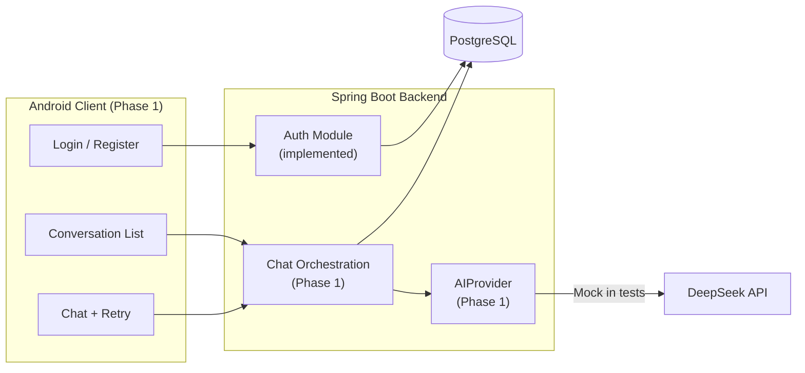

# MIRA — Phase 1: Conversation & Chat Core Checklist

| Attribute | Value |
| :--- | :--- |
| **Document ID** | MIRA-CHK-001 |
| **Classification** | Internal Engineering Specification |
| **Status** | Active Execution Baseline |
| **Version** | 1.0.0 |
| **Last Updated** | 2026-10-21 |
| **Author / Lead** | Bryan / MIRA Core Engineering Team |
| **Phase Milestone** | Phase 1 — End-to-End Text Chat |

---

## Document Revision History

| Version | Date | Author | Description of Changes |
| :--- | :--- | :--- | :--- |
| 1.0.0 | 2026-10-21 | Bryan | Initial Phase 1 baseline: conversation API, message orchestration, provider abstraction, Android client, hardening, CI, and exit gate. |

---

## 1. Purpose & Objectives

Phase 1 delivers the first complete vertical slice of MIRA: a signed-in user can manage conversations and exchange text messages with the assistant from the Android app, with every message and response persisted safely.

Phase 1 objectives:

1. Complete the conversation HTTP API on top of the existing entity and repository.
2. Implement message persistence, response lifecycle, idempotent sends, and bounded retries.
3. Introduce the `AIProvider` abstraction with a DeepSeek client and a deterministic mock.
4. Deliver a usable Android authentication and chat experience with secure token storage.
5. Harden the API contract with request IDs, a complete error envelope, and rate limiting.
6. Establish CI for both projects.

> [!IMPORTANT]
> **Memory is intentionally out of scope for Phase 1.** Phase 1 prompt assembly uses conversation history only. Style-memory governance, extraction, and injection are Phase 2 work and remain specified in [05-memory-lifecycle.md](./05-memory-lifecycle.md).

---

## 2. Scope

### 2.1 In Scope

- Conversation list, create, and delete endpoints with strict ownership checks and cursor pagination.
- Message history retrieval with cursor pagination.
- Synchronous message send with persisted user message and logical AI response.
- Response lifecycle: `PENDING`, `COMPLETED`, `FAILED`, `UNKNOWN`.
- Idempotency-key enforcement, request hashing, and conflict detection.
- Bounded retry endpoint with per-response attempt tracking.
- Provider abstraction, DeepSeek HTTP client, and `MockAIProvider`.
- Per-account rate limiting and request-size limits.
- Request IDs and the enriched error envelope.
- Android login/register, encrypted token storage, conversation list, chat screen, and retry UI.
- GitHub Actions CI for backend and Android.
- Documentation updates for any new migrations or contract changes.

### 2.2 Out of Scope (Deferred)

| Capability | Deferred To |
| :--- | :--- |
| Style-memory governance endpoints (`GET/PUT/PATCH/DELETE /memory/style`) | Phase 2 |
| Memory extraction, hybrid policy engine, OCC/generation commits | Phase 2 |
| Memory injection into prompt assembly | Phase 2 |
| Android memory settings UI | Phase 2 |
| Multimodal PDF/image ingestion | Post-MVP |
| Conversation sharing, multi-user collaboration, push notifications | Post-MVP |
| Production deployment, TLS termination, managed secrets, release signing | Phase 3 |
| Global revocation of all sessions on refresh-token replay | Phase 1 hardening decision (see 4.1) |

---

## 3. Baseline Before Phase 1

| Capability | Current State |
| :--- | :--- |
| Registration, login, refresh, logout, `/me` | Implemented and tested |
| JWT resource-server security and JSON 401/403 responses | Implemented |
| Refresh-token rotation and replay rejection | Implemented (session-scoped revocation) |
| `conversation` table, entity, ownership query, cursor query | Implemented |
| Schema `V1`–`V8` | Implemented |
| Backend test suite | 27 passing tests in the latest local reports |
| Android application | Phase 0 scaffold only |
| CI workflows | Not configured |
| Android debug APK verification | **Carry-over from Phase 0** |

### 3.1 Phase 0 Carry-Over

- [x] Run `.\gradlew.bat assembleDebug` in `android/` and confirm a debug APK is produced.
- [ ] Install the APK on an emulator or physical device and confirm the scaffold launches.
- [ ] Record the Android SDK/build-tools versions used for the verified build.

---

## 4. Delivery Workstreams

### 4.1 Platform & Contract Hardening

- [ ] Add a request-ID filter/servlet component:
  - Read `X-Request-Id` if supplied and well-formed, otherwise generate a UUID.
  - Put the value in the logging MDC and the response header.
  - Include it in every error body as `requestId`.
- [ ] Extend `ApiErrorResponse` to `{ error, message, requestId, details? }` without breaking `error`/`message`.
- [ ] Add a catch-all exception handler returning `500 internal_error` with a sanitized message.
- [ ] Populate `details` for bean-validation failures (`field`, `reason`); avoid leaking class names or SQL.
- [ ] Enforce request limits:
  - [ ] Message content: non-blank, max 4,000 characters.
  - [ ] Conversation title: max 200 characters, trimmed; blank becomes `null`.
  - [ ] List limits: conversations default 20/max 50, messages default 50/max 100.
- [ ] Implement per-account rate limiting for message sends (target: 10 requests/minute) returning `429 rate_limited`.
  - Choose a single-instance in-memory token bucket for the MVP and document the limitation.
  - Do not rate-limit health checks or authentication by the same bucket; use separate policies if auth throttling is added.
- [ ] Enable Actuator liveness/readiness health groups and restrict exposed endpoints to health only.
- [ ] Sanitize logs: no passwords, tokens, prompts, assistant content, or provider payloads.
- [ ] Decide the refresh-token replay policy:
  - [ ] Implement account-wide session revocation on replay, **or**
  - [ ] Record the accepted risk and keep session-scoped revocation, updating [06-security-and-privacy.md](./06-security-and-privacy.md) accordingly.

### 4.2 Conversation API

- [ ] Add DTOs:
  - `CreateConversationRequest(String title)`
  - `ConversationResponse(UUID id, String title, Instant createdAt, Instant updatedAt)`
  - `ConversationPageResponse(List<ConversationResponse> items, String nextCursor)`
- [ ] Add `ConversationService`:
  - [ ] `create(userId, title)`.
  - [ ] `list(userId, limit, cursor)` ordered by `updatedAt DESC, id DESC`.
  - [ ] `delete(userId, conversationId)` with ownership check.
- [ ] Encode the cursor as an opaque token containing `(updatedAt, id)`; reject malformed cursors with `400 invalid_request`.
- [ ] Add `ConversationController`:
  - [ ] `GET /api/v1/conversations` → `200`.
  - [ ] `POST /api/v1/conversations` → `201`.
  - [ ] `DELETE /api/v1/conversations/{conversationId}` → `204`.
- [ ] Return `404 resource_not_found` for unknown or unowned conversations, never `403`, to avoid IDOR enumeration.
- [ ] Ensure conversation deletion cascades to messages and AI responses and does not touch memory state.
- [ ] Tests:
  - [ ] Create/list/delete happy paths.
  - [ ] Newest-first ordering and cursor pagination across pages.
  - [ ] Cross-account list isolation and delete attempts return `404`.
  - [ ] Invalid limit/cursor returns `400`.
  - [ ] Unauthenticated access returns `401`.

### 4.3 Messaging & Response Lifecycle

- [ ] Add JPA entities and enums:
  - `Message` with `MessageRole { USER, ASSISTANT }`.
  - `AiResponse` with `AiResponseStatus { PENDING, COMPLETED, FAILED, UNKNOWN }`.
  - `AiProcessingAttempt` with `AttemptOutcome { IN_PROGRESS, SUCCESS, TIMEOUT, ERROR }`.
- [ ] Add repositories:
  - [ ] Message history by conversation with deterministic cursor ordering.
  - [ ] Idempotency lookup by `(userId, operation, idempotencyKey)`.
  - [ ] Attempt lookup/next-number with a lock safe for concurrent retries.
- [ ] Implement `sendMessage(userId, conversationId, content, idempotencyKey)`:
  - [ ] Validate ownership and content before writing.
  - [ ] Require the `Idempotency-Key` header; missing key returns `400 invalid_request`.
  - [ ] Compute a canonical `request_hash` (for example SHA-256 over conversation ID + normalized content).
  - [ ] In one transaction: persist the user message, create the logical `PENDING` response, and create attempt `IN_PROGRESS`.
  - [ ] On duplicate key with the same hash: return the existing response/status without creating another message or provider call.
  - [ ] On duplicate key with a different hash: return `409 idempotency_conflict`.
- [ ] Assemble provider context:
  - [ ] System instruction establishing the assistant role and current-instruction dominance.
  - [ ] Last 10 messages in chronological order (bounded by a character/token budget).
  - [ ] No style-memory injection in Phase 1.
- [ ] Call the provider outside the persistence transaction; write the outcome in a new transaction.
- [ ] Transition the response:
  - [ ] Success → persist assistant message, link `assistant_message_id`, set `COMPLETED`, attempt `SUCCESS`.
  - [ ] Terminal provider error → `FAILED`, attempt `ERROR` with `error_category`.
  - [ ] Timeout/ambiguous network failure → `UNKNOWN`, attempt `TIMEOUT`; keep the user message.
- [ ] Implement `GET /api/v1/conversations/{conversationId}/messages` with cursor pagination.
  - [ ] Include a `response` object (`id`, `status`, `attemptCount`) on user messages so the client can render and retry `FAILED`/`UNKNOWN` responses that have no assistant message row.
- [ ] Implement retry:
  - [ ] `POST /api/v1/conversations/{conversationId}/responses/{responseId}/retry`.
  - [ ] Only `FAILED` or `UNKNOWN` responses are retryable; otherwise `409` or `400` with a stable code.
  - [ ] Maximum 3 total attempts per logical response (configurable, never unbounded).
  - [ ] Add a new `ai_processing_attempt`; never duplicate the user message or response row.
  - [ ] Reuse the original user prompt for regeneration.
  - [ ] Apply idempotency to retry under `operation = RETRY`; the same key for the same response returns the existing result, and reuse for a different response returns `409 idempotency_conflict`.
- [ ] Tests:
  - [ ] Successful send returns user message + completed assistant response.
  - [ ] Timeout maps to `UNKNOWN` and preserves the user message.
  - [ ] Provider terminal error maps to `FAILED`.
  - [ ] Same key + same payload returns the existing result without a second dispatch.
  - [ ] Same key + different payload returns `409 idempotency_conflict`.
  - [ ] Retry succeeds and increments attempt count; retry limit is enforced.
  - [ ] Cross-account send/list/retry returns `404`.
  - [ ] Empty and oversized content return `400`.

### 4.4 AI Provider Abstraction

- [ ] Define `com.mira.mira_backend.ai.AIProvider` with request/response records and a normalized `AIProviderException` hierarchy (timeout, rate limited, unavailable, invalid output).
- [ ] Implement `DeepSeekAIProvider`:
  - [ ] Use Spring's HTTP client (`RestClient`) with connection timeout 5s and read timeout 30s.
  - [ ] Read `DEEPSEEK_API_KEY`, base URL, and model from configuration; fail fast when the key is missing in non-test profiles.
  - [ ] Map provider HTTP status and JSON errors to domain exceptions.
  - [ ] Never log the API key, prompt, or raw completion body.
- [ ] Implement `MockAIProvider` with configurable scenarios:
  - [ ] Instant success.
  - [ ] Timeout.
  - [ ] HTTP 429 / rate limited.
  - [ ] HTTP 5xx / unavailable.
  - [ ] Malformed/empty output.
- [ ] Add provider selection via Spring profiles/configuration so tests always use the mock.
- [ ] Add HTTP-client tests (for example `MockRestServiceServer`) for status/error mapping; do not require network access.
- [ ] Add a startup guard that prevents the real provider from being used in the `test` profile.

### 4.5 Android Client

- [ ] Add dependencies:
  - [ ] Retrofit + OkHttp + Gson (or an equivalent typed JSON client).
  - [ ] `androidx.security:security-crypto` for `EncryptedSharedPreferences`.
  - [ ] RecyclerView, Material Components, lifecycle components.
- [ ] Build the network layer:
  - [ ] Base URL from `BuildConfig`/resource configuration; no secrets in the APK.
  - [ ] Bearer-token interceptor.
  - [ ] Single-flight `Authenticator` that refreshes on `401`, rotates the stored refresh token, and retries the original request once.
  - [ ] Centralized error parsing for `{ error, message, requestId }`.
- [ ] Implement secure session storage:
  - [ ] Store access token, refresh token, and expiry in `EncryptedSharedPreferences`.
  - [ ] Clear tokens on logout and on unrecoverable refresh failure.
- [ ] Implement UI:
  - [ ] Login and registration screens with validation and inline errors.
  - [ ] Conversation list with pull-to-refresh/pagination, create, and delete.
  - [ ] Chat screen with message history, send box, in-flight indicator, and retry for `FAILED`/`UNKNOWN`.
  - [ ] Generate a new `Idempotency-Key` per logical send and reuse it for retries of the same send.
- [ ] Security configuration:
  - [ ] `android:usesCleartextTraffic="false"` and a network security config that permits only the configured HTTPS host.
  - [ ] Keep `MainActivity` exported as the launcher only; all other components unexported.
  - [ ] Strip tokens, prompts, and completions from logs; guard debug logging with `BuildConfig.DEBUG`.
- [ ] Tests:
  - [ ] Unit tests for token storage, authorization interceptor, and error mapping.
  - [ ] Instrumented smoke test for login → conversation → send with a stubbed backend or mock server.
- [ ] Verify `.\gradlew.bat assembleDebug` and install on a device/emulator.

### 4.6 CI & Documentation

- [ ] Add `.github/workflows/backend.yml`:
  - [ ] JDK 21, Maven cache, `.\mvnw`/`./mvnw verify`.
  - [ ] Docker available for Testcontainers (GitHub-hosted runners provide it).
- [ ] Add `.github/workflows/android.yml`:
  - [ ] JDK 21, Android SDK setup, `assembleDebug`, `testDebugUnitTest`, lint.
- [ ] Upload test reports and the debug APK as workflow artifacts.
- [ ] Require both workflows for merges to the main branch.
- [ ] Update [04-api-contract.md](./04-api-contract.md) examples to match the delivered implementation (including the enriched error envelope).
- [ ] Add new Flyway migrations as `V9+` for any schema change; never edit an applied migration.
- [ ] Keep [03-domain-model.md](./03-domain-model.md) synchronized with the final schema.
- [ ] Update [README.md](../README.md) with Phase 1 status and run instructions.

---

## 5. Phase 1 Test Coverage Target

| Area | Required Verification |
| :--- | :--- |
| Conversation API | CRUD, ordering, cursor pagination, validation, cross-account isolation |
| Message send | Persistence before provider call, success, timeout, terminal failure |
| Idempotency | Same key/same payload replay, same key/different payload conflict, concurrent duplicate |
| Retry | Attempt counting, bound enforcement, no duplicate user message, allowed states only |
| Provider | Success, timeout, 429, 5xx, malformed output, timeout configuration |
| Authorization | Every endpoint scoped to the authenticated principal; unowned IDs return 404 |
| Error contract | Status codes, stable codes, `requestId`, validation details |
| Android | Token storage/refresh, interceptor behavior, API error parsing, smoke flow |
| Build | `mvnw clean verify`, `gradlew assembleDebug`, CI green |

Tests must run without internet access or paid DeepSeek calls. Testcontainers remains the only database dependency.

---

## 6. Requirements Traceability

| Requirement | Phase 1 Deliverable |
| :--- | :--- |
| **FR-003** Conversation Management | Conversation controller, service, DTOs, cursor pagination, cascade delete |
| **FR-004** Text Messaging & AI Orchestration | Message send, lifecycle states, context assembly, persistence |
| **FR-005** Idempotent Retries | Idempotency key/hash, replay behavior, attempt tracking, bounded retry endpoint |
| **FR-010** Data Isolation | Ownership checks on every conversation/message/response operation |
| **FR-011** Error Formatting | `requestId`, `details`, catch-all handler, stable error registry |
| **NFR-003** Fault Isolation | Provider timeout/error mapping; `UNKNOWN` semantics; transactional writes |
| **NFR-004** Performance & Latency | Bounded query limits, 5s/30s provider timeouts |
| **NFR-006** Testability | Mock provider, Testcontainers, deterministic suites, CI |

---

## 7. Risks & Open Decisions

1. **Synchronous provider latency:** Message send may hold an HTTP request for up to 30 seconds. This is acceptable for the MVP; an asynchronous job/polling model can replace it later without changing the persisted lifecycle.
2. **In-memory rate limiting:** A single-instance bucket resets on restart and does not coordinate across replicas. Revisit when the backend scales horizontally.
3. **Replay revocation scope:** Current behavior revokes only the implicated session; the original security draft recommends revoking every session. Phase 1 must either implement account-wide revocation or explicitly accept and document the narrower behavior.
4. **Cursor stability:** Cursors embed `(updatedAt, id)`. Updates to a conversation's `updatedAt` can move it between pages; document this as accepted behavior for the MVP.
5. **Provider model selection:** The DeepSeek model name, pricing, and output limits must be configurable, not hardcoded.
6. **No memory in Phase 1:** Users should not expect personalization yet. The UI should not claim memory is active until Phase 2 ships.
7. **Android minSdk/toolchain:** Java 11 source compatibility, minSdk 26, compileSdk 37. New libraries must support these levels.

---

## 8. Phase 1 Exit Gate

Phase 1 is complete only when every item is verified:

- [ ] `backend`: `.\mvnw.cmd clean verify` passes with zero failures.
- [ ] All new backend tests pass using Testcontainers and `MockAIProvider`; no live DeepSeek calls.
- [ ] Conversation API supports create, list, and delete with ownership and cursor pagination.
- [ ] Sending a message persists the user message before provider dispatch and records the logical response and attempts.
- [ ] Idempotent replay and payload-conflict behavior are covered by tests, including a concurrent duplicate case.
- [ ] Retry is bounded, creates attempts rather than duplicate messages, and only applies to `FAILED`/`UNKNOWN`.
- [ ] The error envelope includes `requestId`, validation `details`, and a sanitized `500` fallback.
- [ ] Rate limiting returns `429 rate_limited` under the configured threshold.
- [ ] Android builds a debug APK, stores tokens encrypted, refreshes on `401`, and completes the manual chat smoke flow on an emulator or device.
- [ ] Android network security config prohibits cleartext traffic.
- [ ] Backend and Android CI workflows pass on the main branch.
- [ ] `README.md` and `04-api-contract.md` match the delivered behavior; `03-domain-model.md` matches all migrations.
- [ ] No secrets, prompts, completions, or tokens appear in logs or committed files.

---

## 9. Phase 2 Preview

Phase 2 delivers the differentiator specified in [05-memory-lifecycle.md](./05-memory-lifecycle.md):

- Style-profile read, replace, toggle, and purge endpoints.
- Candidate extraction gated on `COMPLETED` responses.
- Allow-list schema validation and the hybrid persistence policy.
- OCC version checks plus durable generation locking for deletion-race safety.
- Memory injection into prompt assembly when enabled.
- Android memory inspection, edit, toggle, and purge UI.
- Concurrency test suites `MEM-TEST-01` through `MEM-TEST-07`.
