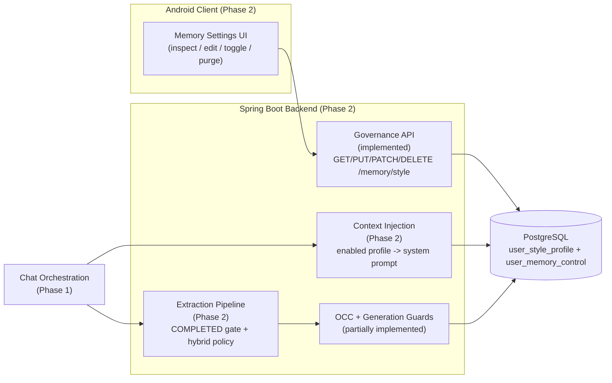

# MIRA — Phase 2: Communication-Style Memory Checklist

| Attribute | Value |
| :--- | :--- |
| **Document ID** | MIRA-CHK-002 |
| **Classification** | Internal Engineering Specification |
| **Status** | Active Execution Baseline |
| **Version** | 1.0.0 |
| **Last Updated** | 2026-10-26 |
| **Author / Lead** | Bryan / MIRA Core Engineering Team |
| **Phase Milestone** | Phase 2 — Communication-Style Memory Subsystem |

---

## Document Revision History

| Version | Date | Author | Description of Changes |
| :--- | :--- | :--- | :--- |
| 1.0.0 | 2026-10-26 | Bryan | Initial Phase 2 baseline: closed Phase 1, recorded implemented backend governance (OCC, allow-list, generation-guarded purge), and scheduled extraction, prompt injection, Android UI, and concurrency suites. |

---

## 1. Purpose & Objectives

Phase 2 delivers MIRA's differentiator: a persistent, user-controlled **communication-style memory** that informs future responses without storing biographical facts. It builds on the completed Phase 1 chat core and the schema introduced in Flyway `V5`/`V6`.

Phase 2 objectives:

1. Finish the governance surface (already implemented on the backend) and exercise it from the Android client.
2. Implement candidate extraction gated strictly on `COMPLETED` assistant responses.
3. Apply the hybrid persistence policy: explicit durable preferences merge automatically, inferred preferences are staged, ephemeral instructions are discarded.
4. Enforce OCC versioning and the durable generation tombstone in the same locked transaction as any profile write.
5. Inject the enabled style profile into prompt assembly while preserving current-instruction dominance.
6. Prove deletion-race and collision safety with `MEM-TEST-01`..`MEM-TEST-07`.

---

## 2. Scope

### 2.1 In Scope

- Style-profile read, replace, toggle, and purge endpoints. *(Backend implemented.)*
- First-read provisioning of `user_style_profile` and `user_memory_control` rows. *(Implemented.)*
- Allow-list schema validation and `409 version_conflict` mapping. *(Implemented.)*
- Generation-guarded purge (`generation += 1` under row lock). *(Implemented.)*
- Candidate extraction and eligibility gating on `COMPLETED` responses.
- Hybrid persistence classification and staging for inferred preferences.
- Asynchronous extraction that never blocks chat latency.
- Memory injection into prompt assembly when `enabled = true`; omission when disabled or purged.
- Android memory inspection, editing, toggling, and purge UI.
- Concurrency and privacy test suites.

### 2.2 Out of Scope (Deferred)

| Capability | Deferred To |
| :--- | :--- |
| Multimodal PDF/image ingestion | Post-MVP (ADR-003) |
| Biographical or multi-domain long-term knowledge | Not in product scope |
| Production deployment, TLS termination, release signing | Phase 3 |
| Vector stores, embeddings, semantic retrieval | Not in product scope (ADR-002) |
| Conversation sharing, collaboration, push notifications | Post-MVP |

---

## 3. Baseline Before Phase 2

| Capability | Current State |
| :--- | :--- |
| Phase 1 chat core | Complete; merged to `main` via PR #5 |
| Schema `V1`–`V9` | Implemented |
| `user_style_profile` / `user_memory_control` tables | Implemented (`V5` / `V6`) |
| Governance endpoints | Implemented (backend) |
| Allow-list validation and OCC | Implemented (backend) |
| Generation-guarded purge | Implemented (backend) |
| Backend test suite | 68 passing tests (5 memory-governance tests included) |
| Extraction pipeline and prompt injection | Not started |
| Android memory UI | Not started |
| Concurrency race suites | Not started |
| Phase 1 open follow-ups | See section 3.1 |

### 3.1 Phase 1 Follow-Ups Carried Forward

These are tracked here because Phase 1 closed with them still open:

- [ ] Install the debug APK on a device/emulator and record the SDK/build-tools versions.
- [ ] Complete the log-sanitization audit.
- [ ] Decide the refresh-token replay policy (account-wide vs session-scoped).
- [ ] Add Android unit tests for token storage, the auth interceptor, and error mapping.
- [ ] Add an instrumented login → conversation → send smoke test.
- [ ] Split `MiraBackendApplicationTests` by domain.

---

## 4. Delivery Workstreams

### 4.1 Memory Governance API

- [x] Add `MemoryController` with:
  - [x] `GET /api/v1/memory/style`.
  - [x] `PUT /api/v1/memory/style` (OCC via `expectedVersion`).
  - [x] `PATCH /api/v1/memory/style/settings` (`enabled` toggle).
  - [x] `DELETE /api/v1/memory/style` (purge).
- [x] Add `StyleProfileService`:
  - [x] First-read provisioning of control and profile rows.
  - [x] Allow-list validation of fields and enum values.
  - [x] OCC version check with `VersionConflictException` → `409 version_conflict`.
  - [x] Enable/disable toggle without deleting the profile.
  - [x] Purge under `SELECT ... FOR UPDATE` that increments `generation` and clears the profile.
- [x] Add DTOs: `StyleProfileResponse`, `MemorySettingsResponse`, `UpdateStyleProfileRequest`, `UpdateMemorySettingsRequest`.
- [x] Add entities/repositories: `UserStyleProfile`, `UserMemoryControl`, and their locking repositories.
- [x] Map `VersionConflictException` in `ApiExceptionHandler` with `details[0].field = expectedVersion`.
- [x] Tests:
  - [x] First read provisions `enabled=true`, `version=1`, empty profile.
  - [x] Replace validates and increments the version.
  - [x] Stale `expectedVersion` returns `409 version_conflict`.
  - [x] Unknown field or enum value returns `400 invalid_request`.
  - [x] Toggle flips `enabled` and increments the version.
  - [x] Purge clears the profile and increments `generation`.
- [ ] Add cross-account isolation tests for every memory endpoint.
- [ ] Add unauthenticated-access tests (`401`) for every memory endpoint.

### 4.2 Candidate Extraction & Eligibility Gate

- [ ] Trigger extraction only after a logical response reaches `COMPLETED`.
- [ ] Never extract from `PENDING`, `FAILED`, or `UNKNOWN` responses.
- [ ] Build an extraction prompt restricted to the allow-listed style fields.
- [ ] Explicitly instruct the model to discard biographical, financial, health, and political content.
- [ ] Validate candidate output against the allow-list; discard malformed candidates.
- [ ] Run extraction asynchronously so chat latency is unaffected.
- [ ] Capture an immutable `expected_generation` when the task is created.
- [ ] Persist extraction attempts/outcomes for audit without storing raw prompts.
- [ ] Tests: `MemoryEligibilityTest`, `MemoryPrivacyAuditTest`.

### 4.3 Hybrid Persistence Policy

- [ ] Classify candidates as explicit durable, inferred, or ephemeral.
- [ ] Auto-merge explicit durable preferences after validation.
- [ ] Stage inferred preferences and require repeated evidence or user confirmation.
- [ ] Discard ephemeral task instructions.
- [ ] Let explicit user corrections overwrite prior memory immediately.
- [ ] Decide and implement where staged candidates live (no table exists yet); document the decision.
- [ ] Tests: `MemoryConflictResolutionTest`.

### 4.4 Concurrency & Tombstone Safety

- [ ] In the commit transaction, lock `user_memory_control` with `SELECT ... FOR UPDATE`.
- [ ] Compare the locked `generation` against the immutable `expected_generation`; abort on mismatch.
- [ ] Verify `enabled = true` under the same lock; abort otherwise.
- [ ] Apply the `version` precondition (OCC) before writing the profile.
- [ ] Commit profile JSONB and version increment atomically.
- [ ] Implement `MEM-TEST-01` through `MEM-TEST-07` from [05-memory-lifecycle.md](./05-memory-lifecycle.md#7-verification--concurrency-test-suite-requirements).

### 4.5 Prompt Injection

- [ ] Fetch the style profile during context assembly.
- [ ] Include the profile only when `enabled = true`.
- [ ] Serialize the profile into an advisory system prompt that cannot override current user instructions.
- [ ] Keep the bounded conversation-history window and payload limits unchanged.
- [ ] Omit memory entirely after purge or while disabled.
- [ ] Tests: enabled vs disabled assembly, current-instruction dominance, purged profile produces no injection.

### 4.6 Android Memory UI

- [ ] Add a memory screen reachable from the main app.
- [ ] Display enabled state, version, and active preferences.
- [ ] Allow manual editing with OCC `expectedVersion`; surface `409 version_conflict` and refresh.
- [ ] Allow toggling memory on/off.
- [ ] Allow purging with a confirmation dialog.
- [ ] Never claim personalization is active while memory is disabled.
- [ ] Unit tests for the memory repository/error mapping; smoke test for the flow.

### 4.7 Documentation & CI

- [x] Update the API contract, domain model, architecture, security, and testing docs for the implemented governance surface.
- [x] Add this Phase 2 checklist and update the overview roadmap.
- [ ] Keep the test inventory and migration baseline current as extraction lands.
- [ ] Add CI coverage for the memory suites; no live provider calls.

---

## 5. Phase 2 Test Coverage Target

| Area | Required Verification |
| :--- | :--- |
| Governance API | Read/replace/toggle/purge happy paths, validation, OCC conflict, auth isolation |
| Eligibility gate | `COMPLETED` only; no writes for `PENDING`/`FAILED`/`UNKNOWN` |
| Hybrid policy | Explicit durable merge, inferred staging, ephemeral discard, correction precedence |
| Concurrency | Generation mismatch aborts, disabled commit aborts, OCC collision, deletion race |
| Injection | Enabled profile injected, disabled/purged profile omitted, current instruction wins |
| Privacy | No biographical extraction, no prompt/token leakage in logs or audit rows |
| Android | Memory screen CRUD, conflict handling, toggle/purge, error parsing |
| Build | `mvnw clean verify`, `gradlew assembleDebug`, CI green |

All tests must run offline against `MockAIProvider` and Testcontainers PostgreSQL.

---

## 6. Requirements Traceability

| Requirement | Phase 2 Deliverable |
| :--- | :--- |
| **FR-006** Persistent Style Profile Retrieval | Governance API and profile read *(implemented)*; injection pending |
| **FR-007** Candidate Extraction & Eligibility Gate | Extraction pipeline gated on `COMPLETED` |
| **FR-008** Hybrid Persistence & Conflict Resolution | Policy classifier, staging, OCC merge *(OCC/validation implemented)* |
| **FR-009** User Memory Governance | Read, replace, toggle, purge *(implemented)*; Android UI pending |
| **NFR-002** Privacy & Data Minimization | Extraction prompt guardrails and privacy audit tests |
| **NFR-005** Maintainability | Memory module isolation behind service boundaries |
| **NFR-006** Testability | Deterministic extraction doubles and concurrency suites |

---

## 7. Risks & Open Decisions

1. **Extraction provider cost and latency:** Extraction adds a second model call per completed response. Batch or debounce if cost becomes material.
2. **No staging table yet:** Inferred candidates need durable storage before confirmation. Decide between a new table and a JSONB staging area; add a forward-compatible migration.
3. **Background execution model:** The MVP has no queue. A simple async executor loses in-flight work on restart; the generation check still prevents resurrection. Choose between a durable outbox and an executor with retry.
4. **Immediate vs eventual injection:** A newly extracted preference may not affect the very next response. Document this so the UI does not overpromise.
5. **Richer profile schema:** Do not expand the allow-list without a migration and validation update.
6. **Prompt-injection safety:** Profile values are fixed enums, which limits injection risk. Keep free-form text out of the profile.
7. **Android offline/conflict UX:** `409 version_conflict` needs a clear refresh-and-retry flow.

---

## 8. Phase 2 Exit Gate

Phase 2 is complete only when every item is verified:

- [x] Backend governance endpoints (read, replace, toggle, purge) pass their tests.
- [x] OCC `version` conflicts return `409 version_conflict`.
- [x] Allow-list violations return `400 invalid_request`.
- [x] Purge increments `generation` and clears the profile atomically.
- [ ] Extraction runs only for `COMPLETED` responses and never blocks chat latency.
- [ ] Explicit durable preferences merge; inferred preferences are staged; ephemeral instructions are discarded.
- [ ] Prompt assembly injects the profile only when enabled and omits it when disabled or purged.
- [ ] `MEM-TEST-01`..`MEM-TEST-07` pass against Testcontainers PostgreSQL.
- [ ] Privacy audit proves no biographical extraction and no sensitive logging.
- [ ] Android memory UI supports inspect, edit, toggle, and purge with conflict handling.
- [ ] `mvnw clean verify` and `gradlew assembleDebug` pass in CI.
- [ ] API contract, domain model, memory spec, and test inventory match delivered behavior.
