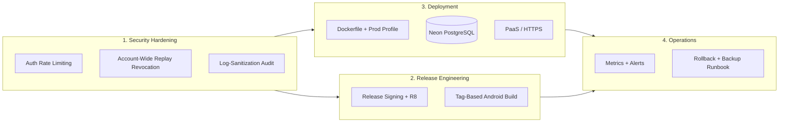

# MIRA — Phase 3: Production Hardening & Deployment Checklist

| Attribute | Value |
| :--- | :--- |
| **Document ID** | MIRA-CHK-003 |
| **Classification** | Internal Engineering Specification |
| **Status** | Active Execution Baseline |
| **Version** | 1.3.0 |
| **Last Updated** | 2026-11-13 |
| **Author / Lead** | Bryan / MIRA Core Engineering Team |
| **Phase Milestone** | Phase 3 — Production Hardening, Deployment, and Operational Readiness |

---

## Document Revision History

| Version | Date | Author | Description of Changes |
| :--- | :--- | :--- | :--- |
| 1.0.0 | 2026-11-13 | Bryan | Initial Phase 3 baseline: security hardening, release signing, backend deployment, observability, Android production readiness, test hardening, and documentation/release. |
| 1.1.0 | 2026-11-13 | Bryan | Completed P3.0 (CI green, Phase 2 closed) and P3.1 (auth rate limiting, account-wide replay revocation, log-sanitization audit). |
| 1.2.0 | 2026-11-14 | Bryan | Completed P3.2 implementation: release signing config, R8 rules, configurable API URL/versioning, local signed APK/AAB verification, tag-based release workflow, and ADR-005. |
| 1.3.0 | 2026-11-14 | Bryan | Completed P3.3 packaging: production Dockerfile, `.dockerignore`, `prod` profile with ECS JSON logs and graceful shutdown, Render blueprint, ADR-004, and a CI container-image build. Live Neon/Render deployment remains. |

---

## 1. Purpose & Objectives

Phase 3 turns the verified Phase 1 chat core and Phase 2 memory subsystem into a deployable, observable, and supportable product. It closes the remaining Phase 1 and Phase 2 operational follow-ups and establishes the production release process.

Phase 3 objectives:

1. Harden authentication and logging before exposing the service publicly.
2. Produce a signed, release-ready Android artifact.
3. Package and deploy the backend with managed PostgreSQL and TLS.
4. Add observability, alerting, rollback, and backup procedures.
5. Verify the end-to-end flow on a physical device against a staging deployment.
6. Leave the repository with current documentation, CI gates, and a repeatable release runbook.

---

## 2. Scope

### 2.1 In Scope

- Authentication rate limiting for login, registration, and refresh.
- Account-wide refresh-token replay revocation.
- Log-sanitization audit and automated verification.
- Dependency and secret scanning for CI.
- Android release signing, R8/ProGuard, configurable API base URL, and release artifacts.
- Backend `Dockerfile`, production profile, health probes, and deployment.
- Neon PostgreSQL provisioning, SSL enforcement, and Flyway migration verification.
- Structured logging, metrics, alerting, backup/restore, and rollback procedures.
- Android unit and instrumented smoke tests for production flows.
- Test-suite restructuring and performance smoke coverage.
- Documentation, release notes, tagging, and the final Phase 3 exit gate.

### 2.2 Out of Scope (Deferred)

| Capability | Deferred To |
| :--- | :--- |
| Multimodal PDF/image ingestion | Post-MVP (ADR-003) |
| Biographical or multi-domain long-term knowledge | Not in product scope |
| Conversation sharing, collaboration, push notifications | Post-MVP |
| Autoscaling, multi-region active-active, service extraction | Post-MVP |
| Vector stores, embeddings, semantic retrieval | Not in product scope (ADR-002) |

---

## 3. Baseline Before Phase 3

| Capability | Current State |
| :--- | :--- |
| Phase 1 chat core | Complete; merged to `main` |
| Phase 2 memory subsystem | Complete; final CI verification pending |
| Backend test suite | 116 passing tests (unit, MockRestServiceServer, Testcontainers PostgreSQL) |
| Android test suite | 4 passing unit tests (`MemoryOptionsTest`, `ExampleUnitTest`) |
| Backend health probes | Implemented (`/actuator/health`, liveness, readiness) |
| Local database | `docker-compose.yml`, `.env.example` |
| CI workflows | Backend verify and Android build/test/lint configured |
| Release signing | Configurable via environment variables / `keystore.properties`; R8 rules and a tag-based release workflow are in place. Keystore creation and GitHub Secrets remain operator steps. |
| Backend container image | Implemented (`backend/Dockerfile`); image builds, runs, migrates, and serves health locally |
| Deployment | Render blueprint ready (`render.yaml`); Neon provisioning and live deployment remain |
| Observability | Request IDs, ECS JSON logs in the `prod` profile, and health probes; metrics and alerts remain |

---

## 4. Delivery Workstreams

### 4.1 P3.0 — Close Phase 2 and Unblock CI

- [x] Replace `android-actions/setup-android@v3` with `@v4` so the removed `tools` SDK package is not requested.
- [x] Install `platforms;android-37` and `build-tools;36.0.0` explicitly.
- [x] Backend and Android workflows green on `main`.
- [x] Check the final Phase 2 exit-gate item in [11-phase-2-checklist.md](./11-phase-2-checklist.md#8-phase-2-exit-gate).
- [x] Mark Phase 2 complete in the roadmap and revision history.

### 4.2 P3.1 — Security Hardening

- [x] Add `AuthRateLimiter` with per-email and per-IP sliding windows.
- [x] Throttle login (5/minute per email, 30/minute per IP), registration (5/minute per IP), and refresh (60/minute per IP).
- [x] Return `429 rate_limited` through the existing error envelope.
- [x] Add `mira.auth.rate-limit.*` configuration and test-profile overrides.
- [x] Revoke every active session for the account on refresh-token replay.
- [x] Add `AuthRateLimiterTests`, `AuthSecurityTest`, and `LogSanitizationTest`.
- [x] Verify `ApiExceptionHandler` logs only the request ID and exception class.
- [ ] Add dependency scanning (Dependabot or OWASP Dependency-Check).
- [ ] Add secret scanning to CI (e.g. `gitleaks`).
- [ ] Document the per-email lockout tradeoff and the trusted-proxy requirement for `X-Forwarded-For`.

### 4.3 P3.2 — Android Release Engineering

- [ ] Create a release keystore outside the repository and back it up securely.
- [x] Add a `release` signing config sourced from environment variables or an untracked `keystore.properties`.
- [x] Add `proguard-rules.pro` / R8 rules for Retrofit, Gson, OkHttp, and AndroidX.
- [x] Replace the hardcoded `https://api.example.com/` release URL with a Gradle property or environment-provided value.
- [x] Add a version-code/version-name strategy and document it.
- [x] Build `assembleRelease` and `bundleRelease` locally (verified with a temporary keystore).
- [x] Add a tag-triggered release workflow that uploads the signed AAB/APK as an artifact.
- [ ] Verify the release artifact installs on a device and reaches staging.

### 4.4 P3.3 — Backend Packaging & Deployment

- [x] Add `backend/Dockerfile` (multi-stage build, JRE 21 runtime, non-root user, healthcheck).
- [x] Add `.dockerignore`.
- [x] Add a `prod` profile with JSON logging, graceful shutdown, Hikari settings, and Flyway on boot.
- [x] Fail fast on missing production secrets (`MIRA_JWT_SECRET_BASE64`, datasource, DeepSeek key).
- [x] Choose the hosting platform and record an ADR (Render + Neon, ADR-004).
- [ ] Provision Neon PostgreSQL, enforce `sslmode=require`, and configure backups.
- [ ] Deploy the backend and verify Flyway `V1`–`V10` against the managed database.
- [ ] Verify `/actuator/health`, liveness, and readiness over public HTTPS.
- [x] Add a CI container-image build and a Render blueprint with auto-deploy.
- [ ] Run the end-to-end smoke flow against staging.

### 4.5 P3.4 — Observability & Operations

- [ ] Enable structured JSON logging.
- [ ] Add Micrometer metrics for chat requests, provider errors/timeouts, extraction jobs, auth failures, and rate limits.
- [ ] Configure alerts for health failures, 5xx spikes, provider latency, and extraction backlog.
- [ ] Document the rollback procedure and exercise it once.
- [ ] Perform a Neon backup/restore drill and record recovery time.
- [ ] Document secret rotation for `DEEPSEEK_API_KEY`, `MIRA_JWT_SECRET_BASE64`, and database credentials.
- [ ] Confirm logs contain no prompts, completions, passwords, tokens, or provider payloads.

### 4.6 P3.5 — Android Production Readiness

- [ ] Add unit tests for `TokenStore`, `AuthInterceptor`, and `ApiError` mapping.
- [ ] Add an instrumented login → conversation → send smoke test against a stub or staging backend.
- [ ] Run `connectedDebugAndroidTest` on an emulator in CI (optional) and locally.
- [ ] Install the debug and release APKs on a physical device; record SDK/build-tools versions.
- [ ] Verify cleartext traffic is disabled in release and the debug overlay is excluded.
- [ ] Verify debug logging is stripped or inert in release builds.
- [ ] Verify the `409 version_conflict` refresh-and-retry flow on a device.
- [ ] Verify offline, timeout, and provider-failure UX.

### 4.7 P3.6 — Test & Quality Hardening

- [ ] Move `MiraBackendApplicationTests` onto `MemoryIntegrationTestSupport` or a shared base to reuse the PostgreSQL container.
- [ ] Split the consolidated test class by domain (auth, conversations, messaging, memory).
- [ ] Add an NFR-004 latency smoke test for local endpoints (p95 target ≤ 200 ms under nominal load).
- [ ] Keep the full suite offline (`MockAIProvider`, Testcontainers) and fast enough for CI.
- [ ] Add release-build verification to the Android workflow.

### 4.8 P3.7 — Documentation & Release

- [ ] Keep this checklist current as workstreams complete.
- [x] Add ADR-005 (release signing).
- [ ] Add ADR-004 (hosting platform).
- [ ] Update [08-deployment-plan.md](./08-deployment-plan.md) with the chosen provider, domains, and runbook.
- [ ] Update the README with deployment, release, and operational instructions.
- [ ] Write release notes and choose the version/tag strategy.
- [ ] Produce the first tagged release artifact and deployment.

---

## 5. Phase 3 Exit Gate

Phase 3 is complete only when every item is verified:

- [ ] Backend and Android CI workflows are green on `main`.
- [ ] Authentication rate limiting and account-wide replay revocation are deployed and verified.
- [ ] Log-sanitization audit passes in the deployed environment.
- [ ] A signed release AAB/APK is produced by CI and installs on a physical device.
- [ ] The release build connects to the staging backend over HTTPS.
- [ ] The backend is deployed to staging with TLS, health probes, and Flyway migrations applied.
- [ ] An end-to-end smoke test (register → login → conversation → message → memory settings) passes against staging.
- [ ] Metrics and alerts are active for health, 5xx, provider errors, and extraction backlog.
- [ ] Backup/restore and rollback procedures have been exercised.
- [ ] Documentation, ADRs, and release notes match the deployed system.

---

## 6. Decisions & Risks

| Decision | Options | Recommendation | Status |
| :--- | :--- | :--- | :--- |
| Hosting platform | Render, Fly.io, AWS ECS | Render for fastest managed HTTPS + secrets + health checks | Open |
| Android distribution | Play Store AAB, direct APK | Play Store AAB; keep a signed APK for device testing | Open |
| Backend domain | Custom domain vs platform domain | `api.<project-domain>` with managed TLS | Open |
| Release keystore storage | Repo-excluded file + GitHub Secrets | Keystore in secure offline storage; CI secrets for passwords | Open |
| Replay revocation scope | Session-scoped, account-wide | Account-wide (implemented) | Resolved |
| Auth throttling scope | Email-only, IP-only, both | Both (implemented; configurable) | Resolved |
| X-Forwarded-For trust | Always, never, configurable | Configurable; enable behind a trusted proxy | Resolved |

| Risk | Impact | Mitigation |
| :--- | :--- | :--- |
| In-memory rate limiters do not coordinate across replicas | Brute force may scale with instance count | Keep a single instance for MVP; move to Redis/API gateway when scaling |
| Per-email login throttling enables short lockout abuse | Minor availability annoyance | Short window, separate IP bucket, configurable limits |
| Stateless access tokens survive replay revocation for up to 15 minutes | Short-lived unauthorized access window | Accepted; documented; shorten access-token lifetime if needed |
| Release keystore loss | Cannot ship updates | Offline backup and documented recovery |
| Provider cost growth | Financial exposure | Rate limits, timeouts, message caps, extraction monitoring |
| Neon connection limits | Pool exhaustion under load | Use the pooled connection string and tune Hikari |

---

## 7. Requirements Traceability

| Requirement | Phase 3 Deliverable |
| :--- | :--- |
| **FR-002** Auth & Session | Authentication rate limiting, account-wide replay revocation, signed release client |
| **NFR-001** Security & Confidentiality | Release signing, TLS deployment, secret isolation, replay revocation |
| **NFR-002** Privacy & Data Minimization | Log-sanitization audit, deployed log verification |
| **NFR-003** Fault Isolation | Production timeouts, graceful shutdown, health probes, alerts |
| **NFR-004** Performance & Latency | Message/auth rate limiters, latency smoke test, pool tuning |
| **NFR-005** Maintainability | Test split by domain, release workflow, runbook |
| **NFR-006** Testability | CI green, instrumented smoke test, offline suites |
